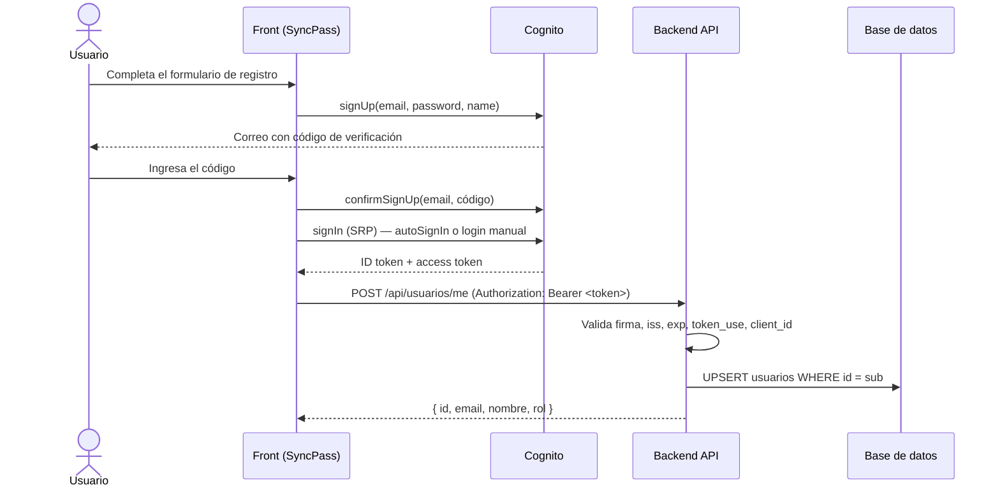

# Registro de usuarios con Cognito + base de datos (especificación para implementar)

> **Estado:** pendiente de implementar. Documento escrito el 2026-10-23.
> **Para quién:** una IA (o persona) que va a implementar el registro de usuarios de SyncPass de forma que el usuario quede en **AWS Cognito** y también en una **base de datos propia**, sin las brechas de seguridad del repo de referencia.

---

## 0. Reglas de trabajo (léelas antes de hacer cualquier cosa)

Estas reglas son obligatorias. Están aquí porque el contexto de este proyecto tiene restricciones que no son obvias.

1. **No des nada por hecho.** Todo lo que este documento describe como "estado actual" puede haber cambiado. Verifícalo leyendo el código antes de usarlo. Si algo no coincide, dilo y pregunta cómo seguir.
2. **Pregunta antes de decidir.** Las preguntas de la [sección 9](#9-preguntas-obligatorias-antes-de-escribir-código) se responden **antes de escribir código**. No elijas tú una respuesta "razonable" para seguir avanzando. Puedes proponer una opción recomendada, pero espera la confirmación.
3. **Si no encuentras algo, detente y pregunta.** Si falta un archivo, una variable, un recurso de AWS, una tabla, un endpoint, una credencial o un dato, no lo inventes ni lo simules. Pregúntale al usuario qué es y dónde está.
4. **No inventes valores.** Nada de IDs de User Pool, Client IDs, URLs, contraseñas, nombres de grupos ni cadenas de conexión de ejemplo puestos como si fueran reales. Si los necesitas, pídelos.
5. **La cuenta AWS es de AWS Academy (voclabs).** En el PC del usuario no hay AWS CLI con credenciales. Cualquier cambio en la consola de AWS (Cognito, EC2, IAM, RDS) **lo hace el usuario**. Tú le das los pasos exactos y le pides que confirme el resultado. Las credenciales de Academy son temporales (expiran cuando termina la sesión del lab), así que no diseñes nada que dependa de claves AWS fijas en un `.env`.
6. **Nunca subas secretos al repositorio** (contraseñas de BD, client secrets, llaves `.pem`, tokens). Revisa `.gitignore` antes de crear archivos con secretos.
7. **Haz el trabajo por fases** ([sección 7](#7-plan-de-implementación-por-fases)) y al cerrar cada fase muestra qué cambió y cómo se verificó. No avances a la siguiente fase si la anterior no funciona.
8. **Si una decisión de seguridad de la [sección 5](#5-requisitos-de-seguridad-obligatorios) no se puede cumplir** (por ejemplo, no hay HTTPS), no la saltes en silencio. Explícale al usuario el riesgo concreto y pregúntale si lo acepta.

---

## 1. Contexto del proyecto (verificar, puede estar desactualizado)

**SyncPass** es un front en **Vite + React 19 + TypeScript**, con rutas en `wouter`. **Este repositorio no tiene backend.**

| Pieza | Dónde | Estado al 2026-10-23 |
|---|---|---|
| Login | `src/auth/cognito.ts`, `src/auth/AuthContext.tsx` | Funciona. Usa **Amplify v6** (`aws-amplify/auth`) directo contra Cognito con `USER_SRP_AUTH` (la contraseña no viaja en texto plano). El token que se guarda en el contexto es el **ID token**. |
| Registro | `src/pages/register/Register.tsx` | **No está conectado.** Solo valida en el navegador (hay un `TODO`). También tiene restos de una llamada de prueba a `rickandmortyapi.com` que hay que eliminar. |
| Cliente HTTP | `src/api/client.ts` | `apiRequest()` con `VITE_API_BASE_URL` y `Authorization: Bearer`. Todavía no se usa para nada real. |
| Cognito | `Amplify.configure` en `src/auth/cognito.ts` | User Pool en `us-east-1`. El **correo es el nombre de usuario**. El App Client **no tiene secreto** (correcto para una SPA). |
| Despliegue del front | `scripts/deploy-ec2.ps1` | EC2 Ubuntu + Nginx en `http://34.239.68.146` (**solo HTTP, sin HTTPS**). |
| Tests | `tests/*.test.mjs` | `node --test`. |

---

## 2. Repositorio de referencia y sus problemas

Repo: <https://github.com/docentedev/fs2-api> (Spring Boot 4, Java 21, PostgreSQL, AWS SDK v2).

Su `POST /api/auth/registro` recibe `{ email, password, nombre, roles }` y hace lo siguiente:
1. `SignUp` en Cognito desde el backend.
2. `AdminAddUserToGroup` por cada rol que **manda el cliente**.
3. Guarda el usuario en PostgreSQL (`usuarios` + `usuario_roles`) usando el `sub` de Cognito como PK.

**Sirve como referencia de la idea, no para copiarlo tal cual.** Estos son los problemas que la implementación nueva tiene que evitar:

| # | Problema en fs2-api | Consecuencia | Cómo se resuelve aquí |
|---|---|---|---|
| P1 | El cliente elige sus roles (`"roles": ["ADMIN"]`) | Cualquiera se registra como administrador | El rol lo asigna **solo el servidor/Cognito**. El front nunca envía roles. |
| P2 | Cognito y la BD no son atómicos (`@Transactional` solo cubre la BD) | Usuarios en Cognito sin fila en la BD. Al reintentar sale "email ya registrado". | Cognito es la fuente de verdad y la BD se sincroniza con un **upsert idempotente** por `sub`. |
| P3 | `roles` nulo provoca un `NullPointerException` **después** de crear el usuario en Cognito | Usuario huérfano + error 500 | No hay roles en la petición (ver P1). |
| P4 | No hay paso de confirmación del correo | El login falla con `UserNotConfirmedException` (sale como 500 genérico) | Flujo de confirmación con código + reenvío de código. |
| P5 | La contraseña pasa por el backend | Con el front en HTTP, la contraseña viaja en texto plano por la red | El front hace `signUp` **directo contra Cognito** (endpoint HTTPS de AWS). El backend nunca ve contraseñas. |
| P6 | El login usa `USER_PASSWORD_AUTH` | Exige habilitar un flujo menos seguro en el App Client | Se mantiene `USER_SRP_AUTH`. **No** se habilita `ALLOW_USER_PASSWORD_AUTH`. |
| P7 | Necesita credenciales IAM (`DefaultCredentialsProvider`) incluso para `SignUp` | No funciona en local con Academy. Lleva a poner claves en `.env`. | El diseño recomendado **no necesita credenciales IAM** (ver sección 4). |
| P8 | El JWT solo se valida por `issuer` (comportamiento por defecto de Spring) | Se aceptan tokens de **otros App Clients** del mismo pool y tokens de un tipo incorrecto | Validar también `token_use` y `client_id`/`aud` (sección 5). |
| P9 | CORS `*` por defecto | Cualquier sitio puede llamar a la API | Mismo origen detrás de Nginx, o CORS limitado al dominio del front. |
| P10 | Las excepciones de Cognito no manejadas terminan en un 500 genérico | El usuario no sabe qué pasó | Mapear cada error a un mensaje claro en español. |
| P11 | `show-sql: true`, `ddl-auto: update` en producción | Logs con datos y cambios de esquema sin control | Desactivar en producción. Esquema con migraciones (preguntar herramienta). |

---

## 3. Objetivo

Cuando una persona se registra en SyncPass:

1. Queda creada en **Cognito** con `email` y `name`.
2. Confirma su correo con el código que le envía Cognito.
3. Queda registrada en la **base de datos** con el mismo identificador (`sub`), su correo, su nombre y su rol.
4. Su rol **no lo elige ella**: por defecto es el rol básico (nombre por confirmar, ver sección 9). Los roles superiores los asigna un administrador.
5. Si algo falla a mitad del proceso, el sistema se recupera solo en el siguiente intento, sin usuarios huérfanos ni errores de "ya existe" que no tengan salida.

---

## 4. Arquitectura recomendada

### Idea central

- **Cognito es la fuente de verdad** para identidad, contraseña, confirmación y roles (grupos).
- **El front habla directo con Cognito** para registrarse, confirmar e iniciar sesión, usando Amplify como ya hace el login.
- **El backend nunca recibe contraseñas.** Solo recibe un JWT de Cognito, lo valida y hace un *upsert* del usuario en la BD.
- **La fila en la BD se crea o actualiza** llamando a `POST /api/usuarios/me` justo después de cada inicio de sesión. La llamada es idempotente: repetirla no duplica nada y corrige cualquier desincronización.



### Por qué así

| Ventaja | Problema que resuelve |
|---|---|
| La contraseña solo va del navegador a Cognito (HTTPS de AWS) | P5, P6 |
| El backend no llama a APIs administrativas de Cognito, así que no necesita IAM | P7 (credenciales temporales de Academy) |
| El upsert por `sub` es idempotente | P2, P3 |
| El rol sale de los grupos de Cognito presentes en el token, y el cliente no puede cambiarlo | P1 |

### Roles (recomendación, confirmar con el usuario)

- **Rol básico implícito:** un usuario **sin grupo** en Cognito es el rol básico. Así nadie tiene que asignarle un grupo al registrarse y no hacen falta permisos IAM.
- **Roles superiores** (p. ej. administrador): grupos de Cognito que asigna **a mano** un administrador desde la consola, o más adelante desde un endpoint solo para administradores.
- El backend calcula el rol a partir del claim `cognito:groups` del token y lo copia en la BD en cada upsert. **La BD es un espejo para consultas, no la fuente de autorización.**

### Qué token usar (decisión a confirmar)

| Opción | Cómo obtiene el backend email y nombre | Notas |
|---|---|---|
| **A. ID token** (lo que el front ya guarda hoy) | Vienen en los claims `email`, `name`, `email_verified` | Más simple. El backend **debe** validar `token_use == "id"` y `aud == <client id>`. |
| **B. Access token** | Llamando a `GetUser(accessToken)` de Cognito (no necesita IAM, se autoriza con el propio token) | Es lo que AWS recomienda para autorizar APIs. Obliga a cambiar `AuthContext` para guardar el access token. El backend valida `token_use == "access"` y `client_id == <client id>`. |

Presenta ambas opciones al usuario y pregunta cuál prefiere. Si no tiene preferencia, recomienda **A** para este proyecto académico por simplicidad, siempre que las validaciones estén completas.

### Alternativa: trigger *Post Confirmation* de Cognito (Lambda)

Cognito puede ejecutar una Lambda cuando el usuario confirma su correo, y esa Lambda escribe en la BD. Es más "automático", pero la Lambda necesita llegar a la BD (red/VPC y secretos), y AWS Academy puede restringir Lambda o los roles disponibles. **No la elijas por tu cuenta.** Menciónala como opción y pregunta si el usuario la quiere y si su lab la permite. Aunque se use, mantén `POST /api/usuarios/me` como red de seguridad idempotente.

### Alternativa NO recomendada: registro a través del backend (como fs2-api)

Úsala solo si el usuario lo pide explícitamente (por ejemplo, porque la pauta del curso lo exige). En ese caso, como mínimo:
- **HTTPS obligatorio** entre el front y el backend, o la contraseña viaja en texto plano.
- El backend ignora cualquier rol que venga en la petición.
- Si falla el guardado en la BD después de `SignUp`, compensar con `AdminDeleteUser`, o dejar el upsert idempotente para que el reintento lo arregle (y que `UsernameExistsException` en el reintento no bloquee).
- Se necesitan credenciales IAM para las APIs `Admin*`. En EC2 eso significa un **instance profile** (p. ej. `LabInstanceProfile`), nunca claves en `.env`. Pregunta si el lab lo permite.

---

## 5. Requisitos de seguridad (obligatorios)

Cada punto tiene que quedar implementado y verificado. Si alguno no se puede cumplir, aplica la regla 8.

**Contraseñas y flujos de Cognito**
- [ ] La contraseña nunca pasa por el backend ni se registra en logs (ni en el front ni en el servidor).
- [ ] El login sigue usando `USER_SRP_AUTH`. No se habilita `ALLOW_USER_PASSWORD_AUTH`.
- [ ] El App Client del front **no tiene client secret**.
- [ ] Las reglas de contraseña del front (`REQUISITOS` en `Register.tsx`: 8+ caracteres, mayúscula, minúscula, número, símbolo) **coinciden** con la política del User Pool. Pide al usuario que confirme la política real.

**Validación del JWT en el backend**
- [ ] Firma verificada con las claves públicas (JWKS) del pool: `https://cognito-idp.<region>.amazonaws.com/<userPoolId>/.well-known/jwks.json`.
- [ ] `iss` igual a `https://cognito-idp.<region>.amazonaws.com/<userPoolId>`.
- [ ] `exp` vigente.
- [ ] `token_use` igual al tipo de token elegido (`id` o `access`).
- [ ] `aud` (ID token) o `client_id` (access token) igual al Client ID del front.
- [ ] Si se usa el `email` del token, solo se acepta cuando `email_verified == true`.

**Datos y autorización**
- [ ] El front **nunca** envía `id`, `rol` ni `roles`. El backend toma `sub`, `email`, `name` y grupos **solo del token validado** e ignora cualquier campo de identidad que llegue en el cuerpo.
- [ ] El upsert es por `id = sub` y es idempotente.
- [ ] El usuario de BD que usa la API tiene solo los permisos necesarios (no superusuario) y la conexión usa SSL si la BD es remota.
- [ ] Ningún secreto queda en el repo. `.env` y `*.pem` están en `.gitignore`.

**Transporte y exposición**
- [ ] **HTTPS** entre navegador y API. Hoy el front está en HTTP. Pregunta si hay o puede haber dominio + certificado (p. ej. Let's Encrypt en Nginx, o CloudFront). Sin HTTPS, los tokens Bearer viajan sin cifrar: explícale el riesgo al usuario y pregúntale si lo acepta para el entorno académico.
- [ ] Recomendado: Nginx sirve el front y hace *reverse proxy* de `/api/` al backend en `127.0.0.1:<puerto>`. Así hay un solo origen, no hace falta CORS y el puerto del backend no queda expuesto. Si no se hace así, CORS solo permite el origen exacto del front, nunca `*`.
- [ ] El puerto del backend no queda abierto en el Security Group si se usa el proxy.

**Errores**
- [ ] Cada error de Cognito o de la API se muestra con un mensaje claro en español (sección 6.3). Nada de 500 genéricos para casos esperables.
- [ ] Los mensajes no revelan detalles internos (stack traces, SQL, nombres de tablas).
- [ ] En producción: `show-sql` desactivado y logs sin tokens.

---

## 6. Contratos

### 6.1 Front → Cognito (Amplify v6, `aws-amplify/auth`)

| Paso | Función | Datos |
|---|---|---|
| Registro | `signUp` | `username: email`, `password`, `options.userAttributes: { email, name }`. Valora `options.autoSignIn: true`. |
| Confirmación | `confirmSignUp` | `username: email`, `confirmationCode` |
| Reenviar código | `resendSignUpCode` | `username: email` |
| Login tras confirmar | `autoSignIn` o el `iniciarSesion` existente | — |

Antes de usar estas funciones, verifica la versión instalada de `aws-amplify` en `package.json` y revisa su firma real en la documentación o en los tipos de `node_modules`. No asumas la firma.

### 6.2 Front → Backend

`POST /api/usuarios/me`

- Header: `Authorization: Bearer <token elegido en la sección 4>`
- Cuerpo: **vacío**. Todo sale del token.
- Respuestas:

| Código | Cuándo | Cuerpo |
|---|---|---|
| `200` | Usuario creado o actualizado | `{ "id": "<sub>", "email": "...", "nombre": "...", "rol": "..." }` |
| `401` | Token ausente, inválido, vencido o de otro cliente | `{ "error": "<mensaje en español>" }` |
| `403` | `email_verified` es falso | `{ "error": "..." }` |
| `500` | Error inesperado (BD caída, etc.) | `{ "error": "<mensaje genérico en español>" }` |

El formato de error tiene que ser compatible con `src/api/client.ts`, que lee `data.error`. Si el backend usa otro formato, ajusta uno de los dos y avísale al usuario.

`GET /api/usuarios/me` (opcional, preguntar): devuelve la fila de la BD del usuario autenticado.

### 6.3 Mensajes de error mínimos del registro (front)

Sigue el patrón de `MENSAJES_ERROR` en `src/auth/cognito.ts`.

| Error de Cognito | Mensaje sugerido |
|---|---|
| `UsernameExistsException` | Ya existe una cuenta con ese correo. Inicia sesión o recupera tu contraseña. |
| `InvalidPasswordException` | La contraseña no cumple los requisitos. |
| `InvalidParameterException` | Revisa los datos ingresados. |
| `CodeMismatchException` | El código no es correcto. Revísalo e intenta de nuevo. |
| `ExpiredCodeException` | El código venció. Te enviamos uno nuevo. (Ofrece reenviar.) |
| `LimitExceededException` / `TooManyRequestsException` | Hiciste demasiados intentos. Espera unos minutos. |
| `UserNotConfirmedException` (en login) | Lleva a la pantalla de confirmación en vez de solo mostrar el error. |

---

## 7. Plan de implementación por fases

### Fase 0: Descubrimiento (sin escribir código)
1. Lee `src/auth/cognito.ts`, `src/auth/AuthContext.tsx`, `src/api/client.ts`, `src/pages/register/Register.tsx`, `src/App.tsx`, `package.json` y `scripts/deploy-ec2.ps1`.
2. Compara lo que encuentres con la sección 1 y reporta las diferencias.
3. Haz **todas** las preguntas de la sección 9 y espera las respuestas.
4. Con las respuestas, resume el diseño final (qué token, dónde vive el backend, qué BD, cómo se asignan los roles, HTTPS sí/no) y pide confirmación.

### Fase 1: Configuración de Cognito (la hace el usuario, tú guías)
Da los pasos exactos de la consola y pide confirmación de cada uno:
- Auto-registro (*self-registration*) habilitado.
- Atributos `email` (verificado) y `name` aceptados en el registro.
- Política de contraseña igual a la del front.
- Verificación por correo activa (código).
- App Client: sin secreto, `ALLOW_USER_SRP_AUTH` y `ALLOW_REFRESH_TOKEN_AUTH` habilitados, `ALLOW_USER_PASSWORD_AUTH` deshabilitado.
- Si se usarán grupos para roles superiores, que existan en el pool con los nombres acordados.

### Fase 2: Base de datos
- Pregunta qué motor y dónde está (sección 9). No crees una BD por tu cuenta.
- Tabla propuesta (ajústala a las respuestas):

```sql
CREATE TABLE usuarios (
    id          VARCHAR(64)  PRIMARY KEY,          -- sub de Cognito
    email       VARCHAR(254) NOT NULL UNIQUE,
    nombre      VARCHAR(100) NOT NULL,
    rol         VARCHAR(30)  NOT NULL,             -- derivado de cognito:groups
    creado_en   TIMESTAMPTZ  NOT NULL DEFAULT now(),
    actualizado_en TIMESTAMPTZ NOT NULL DEFAULT now()
);
```

- Si un usuario puede tener varios roles, pregunta si se necesita una tabla `usuario_roles` como en fs2-api.
- El esquema se crea con migraciones (pregunta la herramienta: Flyway, Liquibase, Prisma, SQL manual…), no con `ddl-auto: update` en producción.

### Fase 3: Backend
- **Pregunta dónde va** (sección 9). Este repo no tiene backend.
- Implementa la validación completa del JWT (sección 5) y `POST /api/usuarios/me` con upsert.
- Si es Spring Boot (como fs2-api): `spring-boot-starter-oauth2-resource-server` con `issuer-uri` y validadores adicionales de `token_use` y `aud`/`client_id`. El rol se obtiene de `cognito:groups`.
- Configuración por variables de entorno, sin valores reales en el código.
- Tests: token válido → 200; token de otro client → 401; token vencido → 401; `email_verified=false` → 403; llamar dos veces → una sola fila; un `rol` enviado en el cuerpo se ignora.

### Fase 4: Front
- `src/auth/cognito.ts`: funciones `registrarCognito`, `confirmarRegistro` y `reenviarCodigo`, con mensajes en español (6.3), siguiendo el estilo existente (`CognitoError`, `mensajeDeError`).
- `src/auth/AuthContext.tsx`: después de cada inicio de sesión exitoso (y al recuperar una sesión guardada, si se acuerda así), llamar a `POST /api/usuarios/me` con `apiRequest`. Si esa llamada falla, **no** cerrar la sesión de Cognito: mostrar un aviso y reintentar en el próximo inicio de sesión (es idempotente).
- `src/pages/register/Register.tsx`: reemplazar el `TODO` por `signUp` real, agregar el paso de confirmación de código (con "reenviar código") y eliminar la llamada de prueba a `rickandmortyapi.com`.
- Login: si Cognito responde `UserNotConfirmedException` o el paso `CONFIRM_SIGN_UP`, llevar al usuario a confirmar su cuenta.
- Tests en `tests/` siguiendo el estilo de `tests/cognito.test.mjs` para el mapeo de errores.

### Fase 5: Despliegue
- Pregunta cómo y dónde se despliega el backend.
- Si va en la misma EC2: servicio `systemd`, Nginx con `location /api/` → `proxy_pass http://127.0.0.1:<puerto>`, puerto del backend cerrado en el Security Group.
- `VITE_API_BASE_URL` vacío si es el mismo origen. Si no, la URL HTTPS del backend.
- Recuerda que tú no puedes usar la llave SSH ni la consola de AWS: dale al usuario los comandos y pídele la salida.

---

## 8. Criterios de aceptación

- [ ] Una persona nueva se registra, recibe el código, confirma e inicia sesión desde SyncPass.
- [ ] Después del primer inicio de sesión existe **una** fila en `usuarios` con `id = sub` de Cognito y el rol básico.
- [ ] Si la BD estaba caída en el primer inicio de sesión, el siguiente crea la fila sin intervención manual.
- [ ] Mandar `"rol": "ADMIN"` (o cualquier campo de identidad) en el cuerpo no cambia nada.
- [ ] Un token emitido para otro App Client es rechazado con 401.
- [ ] Ninguna petición al backend contiene la contraseña (revisado en la pestaña Red del navegador).
- [ ] Al asignar a un usuario a un grupo superior en Cognito, la BD refleja el rol nuevo en su siguiente inicio de sesión.
- [ ] `npm run build`, `npm run lint` y `npm test` pasan, igual que los tests del backend.
- [ ] No hay secretos en el repo (`git grep` de contraseñas, IDs de secreto, `.pem`).

---

## 9. Preguntas obligatorias antes de escribir código

Házselas al usuario (puedes agruparlas). No continúes sin las respuestas que afecten a la fase en curso.

**Backend**
1. ¿Dónde va a vivir el backend: un fork o copia de `fs2-api`, un repo nuevo o una carpeta dentro de este repo?
2. ¿Qué tecnología: Spring Boot (como fs2-api), Node/Express u otra? ¿La pauta del curso exige alguna?
3. ¿Dónde se despliega: la misma EC2 del front (`34.239.68.146`), otra instancia, otro servicio?

**Base de datos**
4. ¿Qué motor y dónde está (PostgreSQL en Supabase, RDS, local, otro)? ¿Ya existe?
5. ¿Quién me da la cadena de conexión y cómo la configuramos sin subirla al repo?
6. ¿Qué herramienta de migraciones usamos?
7. ¿Un usuario tiene un solo rol o varios?

**Cognito**
8. ¿El User Pool sigue siendo el de `src/auth/cognito.ts`? ¿Tiene el auto-registro habilitado?
9. ¿Cuál es exactamente la política de contraseñas del pool?
10. ¿El atributo `name` está habilitado o es obligatorio en el pool?
11. ¿Cómo se llama el rol básico (p. ej. `ALUMNO`) y qué roles superiores existen? ¿Ya hay grupos creados?
12. ¿Te sirve que el rol básico sea "sin grupo" y que los roles superiores se asignen a mano en la consola, o necesitas otra cosa?
13. ¿Quieres usar el trigger *Post Confirmation* (Lambda)? ¿Tu lab de Academy permite crear Lambdas con acceso a la BD?

**Tokens y seguridad**
14. ¿Usamos el ID token (opción A) o el access token (opción B) para hablar con el backend?
15. ¿Hay o puede haber HTTPS (dominio + certificado)? Si no, ¿aceptas el riesgo de enviar tokens por HTTP en el entorno académico?
16. ¿Hacemos el *reverse proxy* `/api/` en Nginx (mismo origen) o el backend va en otro dominio con CORS?

**Alcance**
17. ¿Se necesita también `GET /api/usuarios/me`, edición de perfil o un panel de administración de roles, o solo el registro?
18. ¿El registro debe iniciar sesión automáticamente después de confirmar (`autoSignIn`) o llevar al login?

---

## 10. Fuera de alcance (salvo que el usuario lo pida)

- Login social (Google, etc.) y Hosted UI de Cognito.
- MFA.
- Recuperación de contraseña (se puede hacer después con `resetPassword` / `confirmResetPassword` de Amplify, directo contra Cognito).
- Panel de administración de usuarios.
- Borrado de cuenta y sincronización de borrados entre Cognito y la BD.
