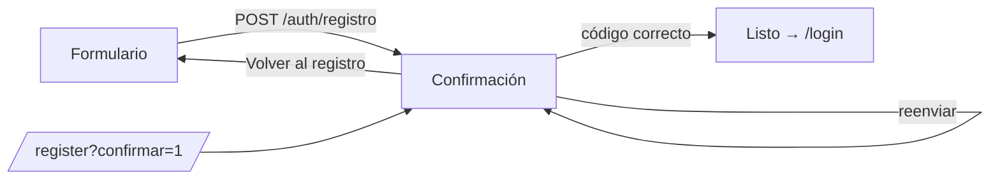
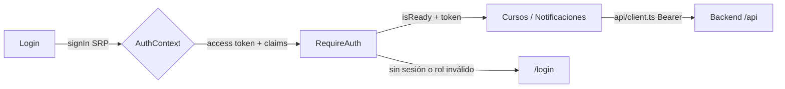
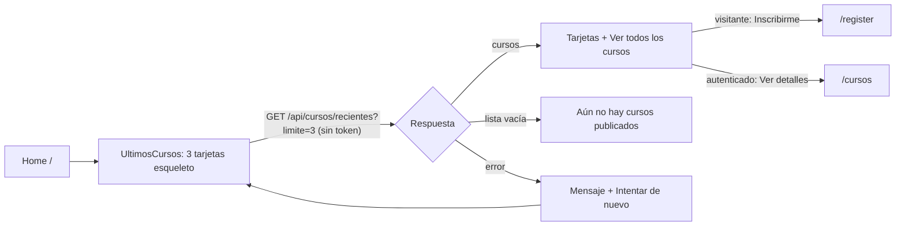
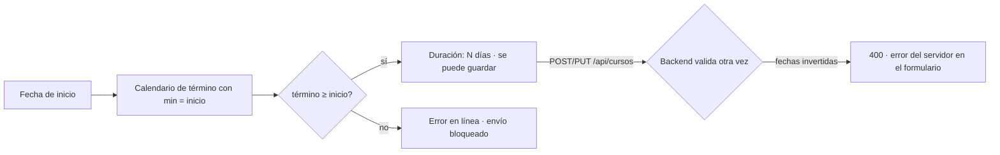

# ALCANCE — requisitos, casos de uso y flujos (front SyncPass)

> **Corte:** 2026-11-19. Estado verificado en `fullstack2-proyecto-kt`. Los sistemas externos (backend, Supabase, Cognito, Android) se tratan según la evidencia disponible en este repo; ver [ARQUITECTURA.md](./ARQUITECTURA.md).

## Requisitos funcionales (RF)

| ID | Requisito | Estado | Evidencia en el repo |
|---|---|---|---|
| RF-01 | Registro de cuenta con nombre, correo, teléfono E.164 y contraseña; **sin campo de rol** | Implementado | `src/pages/register/Register.tsx`, `src/api/registro.ts`, `src/utils/telefono.ts`; tests `tests/registro.test.ts`, `tests/telefono.test.ts` |
| RF-02 | Confirmación de correo con código de 6 dígitos | Implementado | `confirmarRegistro({email,codigo})` → `POST /auth/registro/confirmar`; test `tests/registro.test.ts` |
| RF-03 | Reenvío de código de verificación | Implementado | `reenviarCodigo({email})` → `POST /auth/registro/reenviar-codigo`; test `tests/registro.test.ts` |
| RF-04 | Acceso directo a confirmación desde `/register?confirmar=1` | Implementado | `Register.tsx` (`useSearch`) |
| RF-05 | Inicio de sesión con correo y contraseña (Amplify SRP) y validación de campos | Implementado | `Login.tsx`, `auth/cognito.ts`; test `tests/login.test.tsx` |
| RF-06 | Restauración de sesión al recargar y estado `isReady` | Implementado | `src/contexts/AuthContext.tsx` (`useEffect` con `obtenerSesion`) |
| RF-07 | Cierre de sesión | Implementado | `AuthContext.cerrarSesion`, `Header.tsx`; test `tests/login.test.tsx` |
| RF-08 | Protección de rutas `/cursos` y `/notifications` (sesión + token) | Implementado | `templates/RequireAuth.tsx` en `App.tsx`; test `tests/require-auth.test.tsx` |
| RF-09 | Listado y detalle (en diálogo) de cursos para usuarios autenticados | Implementado | `pages/cursos/Cursos.tsx`, `molecules/Dialogo.tsx`, `api/cursos.ts`; tests `tests/cursos-page.test.tsx`, `tests/cursos.test.ts` |
| RF-10 | Crear, editar y desactivar cursos (solo administrador en la UI); desactivar y descartar cambios piden confirmación en un diálogo | Implementado | `Cursos.tsx`, `organisms/CursoForm.tsx`, `molecules/Dialogo.tsx`; tests `tests/cursos-page.test.tsx`, `tests/curso-form.test.tsx`, `tests/cursos.test.ts` |
| RF-11 | Envío manual de notificaciones a todos o a roles concretos (administrador) | Implementado | `pages/notifications/Notifications.tsx`, `api/notifications.ts`; tests `tests/notifications.test.ts`, `tests/notifications-page.test.tsx` |
| RF-12 | Historial de notificaciones | Parcial | Contrato tipado `getHistorial(): Promise<HistorialResponse>` (`HistorialItem`: `id`, `titulo`, `cuerpo`, `roles`, `enviadoEn`, `dispositivosEnviados`, igual al record del backend) y lista en la UI (`utils/notificaciones.ts`). El backend real devuelve siempre `[]`, así que en uso real se ve el estado vacío; tests `tests/notifications.test.ts`, `tests/notifications-page.test.tsx`, `tests/notificaciones-formato.test.ts` |
| RF-13 | Página 404 y enlace de retorno | Implementado | `pages/not-found/NotFound.tsx` (vista migrada a Tailwind); test `tests/app.test.tsx` |
| RF-14 | Navegación según rol en el encabezado (administrador ve gestión de cursos y notificaciones) | Implementado | `organisms/Header.tsx`; test `tests/app.test.tsx` (render básico con visitante) |
| RF-15 | Autenticación/control de acceso **real** en el backend por endpoint | Fuera de este repo | La SPA envía Bearer; la autoridad la aplica el backend (ver `docs/07`) |
| RF-16 | Persistencia offline, cola de sincronización y MVVM Android | Backlog / otro repo | No existe en este repositorio (`docs/08`, `docs/11`) |
| RF-17 | Últimos cursos en el inicio: la portada muestra los 3 cursos activos más recientes desde el endpoint público `GET /api/cursos/recientes?limite=3`, con estados de carga, vacío y error con reintento; «Inscribirme» (visitante → `/register`) o «Ver detalles» (autenticado → `/cursos`) | Implementado | `pages/home/UltimosCursos.tsx`, `api/cursos.ts` (`listarCursosRecientes`, sin token); tests `tests/ultimos-cursos.test.tsx`, `tests/cursos.test.ts` |
| RF-18 | Validación de fechas del curso: la fecha de término debe ser igual o posterior a la de inicio (el mismo día es válido) | Implementado | `utils/curso.ts` (`validarCurso`), `organisms/CursoForm.tsx` (`min` en el calendario, error en línea y envío bloqueado); el backend repite la regla (400). Tests `tests/curso-validacion.test.ts`, `tests/curso-form.test.tsx` |

## Requisitos no funcionales (RNF)

| ID | Requisito | Estado | Detalle |
|---|---|---|---|
| RNF-01 | Stack React 19 + TypeScript + Vite + Wouter | Implementado | `package.json`, `vite.config.ts`, `App.tsx` |
| RNF-02 | La contraseña nunca se envía al backend en el login (SRP) | Implementado | `signIn` de Amplify; `AuthContext` solo guarda tokens |
| RNF-03 | Token de acceso enviado como `Authorization: Bearer` | Implementado | `api/client.ts`; verificado en tests de API |
| RNF-04 | El front no decide el rol de registro; roles desde `cognito:groups` | Implementado | `registro.ts` sin rol; `usuarioDesdeClaims` en `cognito.ts` |
| RNF-05 | Errores y mensajes en español, accesibilidad básica (roles ARIA, foco, `saltar-contenido`) | Implementado | Componentes y estados de carga/error; tests RTL |
| RNF-06 | Pruebas unitarias + cobertura mínima 30% | Implementado | Vitest + RTL + V8: 84 pruebas, 65,44% líneas (umbral 30 en 4 métricas). `coverage/` con text/json-summary/lcov |
| RNF-07 | CI ejecuta pruebas/cobertura y publica artifact | Implementado | `.github/workflows/deploy.yml` (job `build`, sin tocar `deploy`) |
| RNF-08 | Estilos con CSS Modules y tokens; Tailwind en componentes seleccionados | Implementado | Atomic Design en `components/*`. Tailwind v4 (theme + utilities, sin preflight) en `Logo`, `Alerta`, `Card`, `Footer`, `RequireAuth`, `NotFound` y la lista del historial; el reset de elementos va en `@layer base`. El resto con CSS Modules (ver `ARQUITECTURA.md`) |
| RNF-09 | Sin secretos en el repo | Implementado | IDs de pool/client son configuración pública presente en `cognito.ts`; `.gitignore` excluye `*.pem`, `*.local`, `coverage` |
| RNF-10 | HTTPS de punta a punta | Pendiente / riesgo externo | `docs/07` T6/P6.2: el despliegue en EC2 se documenta solo con HTTP; requiere decisión del usuario |
| RNF-11 | Diseño responsive y prefers-reduced-motion | Implementado | `src/index.css`, media queries en CSS Modules |
| RNF-12 | Dos APIs nativas Android, offline-first y sincronización | Backlog / otro repo | No verificable aquí |
| RNF-13 | Arquitectura en capas: `pages`, `components` (Atomic Design), `hooks`, `contexts`, `api` (clients con tipos de Request/Response) y `utils` | Implementado | `src/pages`, `src/components`, `src/hooks`, `src/contexts`, `src/api`, `src/utils`; ver `ARQUITECTURA.md` |

## Casos de uso

| ID | Actor | Caso de uso | Resultado |
|---|---|---|---|
| CU-01 | Visitante | Crear cuenta | Formulario → código por correo → cuenta confirmada → `/login` |
| CU-02 | Visitante | Confirmar cuenta con código recibido | Estado «listo»; enlace a login |
| CU-03 | Visitante | Pedir otro código | Aviso de correo reenviado |
| CU-04 | Visitante | Iniciar sesión | Sesión activa y navigate a `/`; si la cuenta no está confirmada, enlace a confirmación |
| CU-05 | Usuario autenticado | Recargar la página | Sesión restaurada desde Amplify; `isReady` evita parpadeo de guard |
| CU-06 | Usuario autenticado | Ver catálogo y detalle de cursos | Lista con `Bearer`; detalle en un diálogo |
| CU-07 | Administrador | Crear/editar/desactivar curso | Formulario validado (término ≥ inicio, largos máximos) y operaciones POST/PUT/PATCH; desactivar pide confirmación en un diálogo |
| CU-08 | Administrador | Enviar notificación manual | `POST /notifications/manual` con roles opcionales; mensaje de confirmación |
| CU-09 | Administrador | Consultar historial | Lista tipada (fecha, destinatarios, dispositivos); con el backend actual, estado vacío |
| CU-10 | Visitante / rol incorrecto | Acceder a ruta protegida | `RequireAuth` redirige a `/login`; `Notifications` muestra «Acceso denegado» al rol no admin |
| CU-11 | Cualquiera | Visitar ruta desconocida | Vista 404 |
| CU-12 | Cualquiera | Ver los últimos cursos en el inicio | Hasta 3 cursos recientes sin iniciar sesión; si falla, mensaje e «Intentar de nuevo»; «Inscribirme» lleva a crear cuenta |
| CU-13 | Administrador | Ingresar un periodo inválido al crear o editar un curso | El calendario no ofrece días anteriores al inicio; si la fecha de término queda antes, se muestra «La fecha de término no puede ser anterior al inicio (…)» y no se envía |

## Flujos principales

### Registro y confirmación

### Login y acceso a rutas protegidas

### Últimos cursos en el inicio

### Validación de fechas al crear o editar un curso

### Roles (reglas efectivas en la SPA)

| Rol (`cognito:groups`) | Header | Inicio: últimos cursos | `/cursos` | `/notifications` | Acciones admin |
|---|---|---|---|---|---|
| Sin sesión | Ingresar / Crear cuenta | «Inscribirme» → `/register` | Redirige a `/login` | Redirige a `/login` | No |
| `BENEFICIARIO` / `COORDINADOR` / `VOLUNTARIO` | Enlace «Cursos» | «Ver detalles» → `/cursos` | Lista y detalle | «Acceso denegado» | No |
| `ADMINISTRADOR` | «Gestión de cursos» + «Notificaciones» | «Ver detalles» → `/cursos` | Lista + crear/editar/desactivar | Panel de envío + historial | Sí (UI); el backend vuelve a autorizar |

> El guard `RequireAuth` admite `roles` opcionales (probado con rol incorrecto) pero en `App.tsx` se usa sin `roles` para conservar el mensaje de acceso denegado del panel. La autorización real **siempre** la aplica el backend.

## Backlog (no implementado aquí)

1. Persistir el historial de notificaciones en el backend (hoy responde siempre `[]`); el front ya tiene el contrato tipado y la lista.
2. Acciones administrativas de roles/usuarios y recuperación de contraseña.
3. Inscripción a cursos y pase QR del participante en la web: «Inscribirme» hoy lleva a crear cuenta y `PassCard` es solo una ilustración.
4. Integración punta a punta con Cognito + backend + Supabase reales (las pruebas son simuladas).
5. HTTPS y despliegue del backend/API detrás del front; definir si API Gateway entra en producción (`docs/07` T6).
6. Requisitos Android de la rúbrica: MVVM, Room/SQLite/DataStore, dos APIs nativas, escaneo y acreditación, offline y sincronización (otro repositorio; no verificable aquí).
7. Cobertura del `AuthContext` real y de `Register` completo (hoy se cubren sobre todo contratos y estados de UI; `Cursos` ya tiene test RTL de página).
