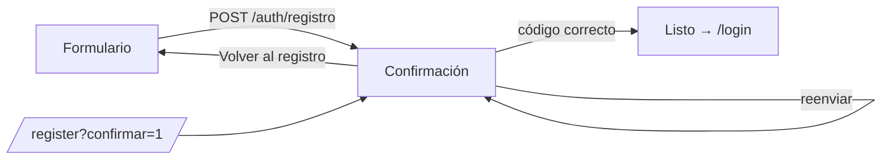

# ALCANCE — requisitos, casos de uso y flujos (front SyncPass)

> **Corte:** 2026-11-17. Estado verificado en `fullstack2-proyecto-kt`. Los sistemas externos (backend, Supabase, Cognito, Android) se tratan según la evidencia disponible en este repo; ver [ARQUITECTURA.md](./ARQUITECTURA.md).

## Requisitos funcionales (RF)

| ID | Requisito | Estado | Evidencia en el repo |
|---|---|---|---|
| RF-01 | Registro de cuenta con nombre, correo, teléfono E.164 y contraseña; **sin campo de rol** | Implementado | `src/pages/register/Register.tsx`, `src/api/registro.ts`; test `tests/registro.test.ts` |
| RF-02 | Confirmación de correo con código de 6 dígitos | Implementado | `confirmarRegistro({email,codigo})` → `POST /auth/registro/confirmar`; test `tests/registro.test.ts` |
| RF-03 | Reenvío de código de verificación | Implementado | `reenviarCodigo({email})` → `POST /auth/registro/reenviar-codigo`; test `tests/registro.test.ts` |
| RF-04 | Acceso directo a confirmación desde `/register?confirmar=1` | Implementado | `Register.tsx` (`useSearch`) |
| RF-05 | Inicio de sesión con correo y contraseña (Amplify SRP) y validación de campos | Implementado | `Login.tsx`, `auth/cognito.ts`; test `tests/login.test.tsx` |
| RF-06 | Restauración de sesión al recargar y estado `isReady` | Implementado | `AuthContext.tsx` (`useEffect` con `obtenerSesion`) |
| RF-07 | Cierre de sesión | Implementado | `AuthContext.cerrarSesion`, `Header.tsx`; test `tests/login.test.tsx` |
| RF-08 | Protección de rutas `/cursos` y `/notifications` (sesión + token) | Implementado | `templates/RequireAuth.tsx` en `App.tsx`; test `tests/require-auth.test.tsx` |
| RF-09 | Listado y detalle de cursos para usuarios autenticados | Implementado | `pages/cursos/Cursos.tsx`, `api/cursos.ts`; tests `tests/cursos.test.ts` |
| RF-10 | Crear, editar y desactivar cursos (solo administrador en la UI) | Implementado | `Cursos.tsx`, `organisms/CursoForm.tsx`; tests `tests/curso-form.test.tsx`, `tests/cursos.test.ts` |
| RF-11 | Envío manual de notificaciones a todos o a roles concretos (administrador) | Implementado | `pages/notifications/Notifications.tsx`, `api/notifications.ts`; tests `tests/notifications.test.ts`, `tests/notifications-page.test.tsx` |
| RF-12 | Historial de notificaciones | Parcial | `getHistorial(): Promise<unknown[]>`; backend real devuelve `[]`. La UI muestra estado vacío; no hay campos ni presentación de registros |
| RF-13 | Página 404 y enlace de retorno | Implementado | `pages/not-found/NotFound.tsx` (vista migrada a Tailwind); test `tests/app.test.tsx` |
| RF-14 | Navegación según rol en el encabezado (administrador ve gestión de cursos y notificaciones) | Implementado | `organisms/Header.tsx`; test `tests/app.test.tsx` (render básico con visitante) |
| RF-15 | Autenticación/control de acceso **real** en el backend por endpoint | Fuera de este repo | La SPA envía Bearer; la autoridad la aplica el backend (ver `docs/07`) |
| RF-16 | Persistencia offline, cola de sincronización y MVVM Android | Backlog / otro repo | No existe en este repositorio (`docs/08`, `docs/11`) |

## Requisitos no funcionales (RNF)

| ID | Requisito | Estado | Detalle |
|---|---|---|---|
| RNF-01 | Stack React 19 + TypeScript + Vite + Wouter | Implementado | `package.json`, `vite.config.ts`, `App.tsx` |
| RNF-02 | La contraseña nunca se envía al backend en el login (SRP) | Implementado | `signIn` de Amplify; `AuthContext` solo guarda tokens |
| RNF-03 | Token de acceso enviado como `Authorization: Bearer` | Implementado | `api/client.ts`; verificado en tests de API |
| RNF-04 | El front no decide el rol de registro; roles desde `cognito:groups` | Implementado | `registro.ts` sin rol; `usuarioDesdeClaims` en `cognito.ts` |
| RNF-05 | Errores y mensajes en español, accesibilidad básica (roles ARIA, foco, `saltar-contenido`) | Implementado | Componentes y estados de carga/error; tests RTL |
| RNF-06 | Pruebas unitarias + cobertura mínima 30% | Implementado | Vitest + RTL + V8: 44,56% líneas (umbral 30 en 4 métricas). `coverage/` con text/json-summary/lcov |
| RNF-07 | CI ejecuta pruebas/cobertura y publica artifact | Implementado | `.github/workflows/deploy.yml` (job `build`, sin tocar `deploy`) |
| RNF-08 | Estilos con CSS Modules y tokens; Tailwind acotado | Implementado | Atomic Design en `components/*`; Tailwind solo en `NotFound`; preflight omitido |
| RNF-09 | Sin secretos en el repo | Implementado | IDs de pool/client son configuración pública presente en `cognito.ts`; `.gitignore` excluye `*.pem`, `*.local`, `coverage` |
| RNF-10 | HTTPS de punta a punta | Pendiente / riesgo externo | `docs/07` T6/P6.2: el despliegue en EC2 se documenta solo con HTTP; requiere decisión del usuario |
| RNF-11 | Diseño responsive y prefers-reduced-motion | Implementado | `src/index.css`, media queries en CSS Modules |
| RNF-12 | Dos APIs nativas Android, offline-first y sincronización | Backlog / otro repo | No verificable aquí |

## Casos de uso

| ID | Actor | Caso de uso | Resultado |
|---|---|---|---|
| CU-01 | Visitante | Crear cuenta | Formulario → código por correo → cuenta confirmada → `/login` |
| CU-02 | Visitante | Confirmar cuenta con código recibido | Estado «listo»; enlace a login |
| CU-03 | Visitante | Pedir otro código | Aviso de correo reenviado |
| CU-04 | Visitante | Iniciar sesión | Sesión activa y navigate a `/`; si la cuenta no está confirmada, enlace a confirmación |
| CU-05 | Usuario autenticado | Recargar la página | Sesión restaurada desde Amplify; `isReady` evita parpadeo de guard |
| CU-06 | Usuario autenticado | Ver catálogo y detalle de cursos | Lista con `Bearer`; detalle bajo demanda |
| CU-07 | Administrador | Crear/editar/desactivar curso | Formulario validado y operaciones PATCH/PUT/POST |
| CU-08 | Administrador | Enviar notificación manual | `POST /notifications/manual` con roles opcionales; mensaje de confirmación |
| CU-09 | Administrador | Consultar historial | Estado vacío real del backend; presentación de registros en backlog |
| CU-10 | Visitante / rol incorrecto | Acceder a ruta protegida | `RequireAuth` redirige a `/login`; `Notifications` muestra «Acceso denegado» al rol no admin |
| CU-11 | Cualquiera | Visitar ruta desconocida | Vista 404 |

## Flujos principales

### Registro y confirmación


### Login y acceso a rutas protegidas
```mermaid
flowchart LR
  A[Login] -->|signIn SRP| B{AuthContext}
  B -->|access token + claims| C[RequireAuth]
  C -->|isReady + token| D[Cursos / Notificaciones]
  C -->|sin sesión o rol inválido| E[/login]
  D -->|api/client.ts Bearer| F[Backend /api]
```

### Roles (reglas efectivas en la SPA)

| Rol (`cognito:groups`) | Header | `/cursos` | `/notifications` | Acciones admin |
|---|---|---|---|---|
| Sin sesión | Ingresar / Crear cuenta | Redirige a `/login` | Redirige a `/login` | No |
| `BENEFICIARIO` / `COORDINADOR` / `VOLUNTARIO` | Enlace «Cursos» | Lista y detalle | «Acceso denegado» | No |
| `ADMINISTRADOR` | «Gestión de cursos» + «Notificaciones» | Lista + crear/editar/desactivar | Panel de envío + historial | Sí (UI); el backend vuelve a autorizar |

> El guard `RequireAuth` admite `roles` opcionales (probado con rol incorrecto) pero en `App.tsx` se usa sin `roles` para conservar el mensaje de acceso denegado del panel. La autorización real **siempre** la aplica el backend.

## Backlog (no implementado aquí)

1. Presentación real del historial de notificaciones cuando el backend entregue campos (hoy `[]`).
2. Acciones administrativas de roles/usuarios y recuperación de contraseña.
3. Integración punta a punta con Cognito + backend + Supabase reales (las pruebas son simuladas).
4. HTTPS y despliegue del backend/API detrás del front; definir si API Gateway entra en producción (`docs/07` T6).
5. Requisitos Android de la rúbrica: MVVM, Room/SQLite/DataStore, dos APIs nativas, offline y sincronización (otro repositorio).
6. Cobertura del `AuthContext` real y de `Register`/`Cursos` completos (hoy se cubren sobre todo contratos y estados de UI).
