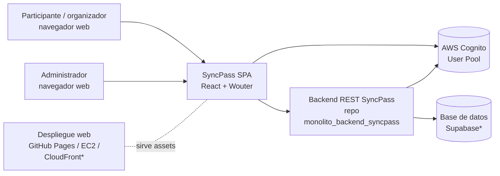
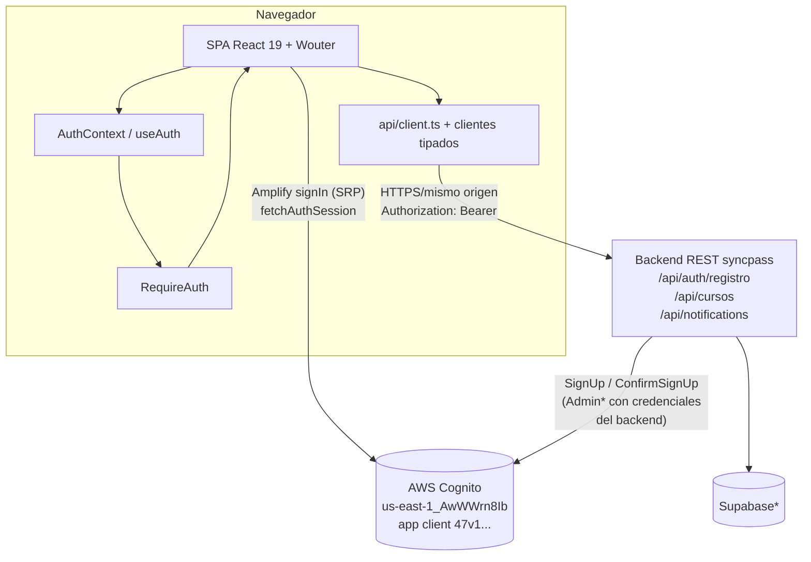
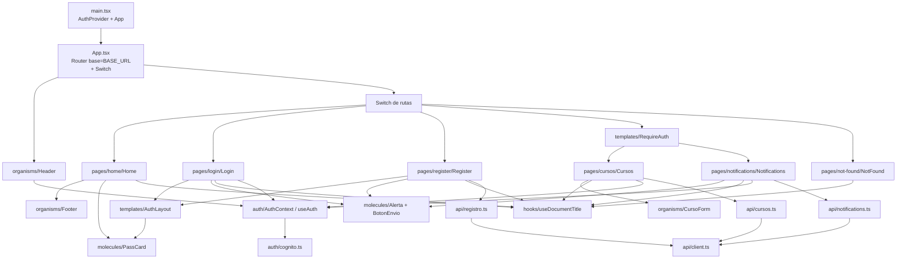
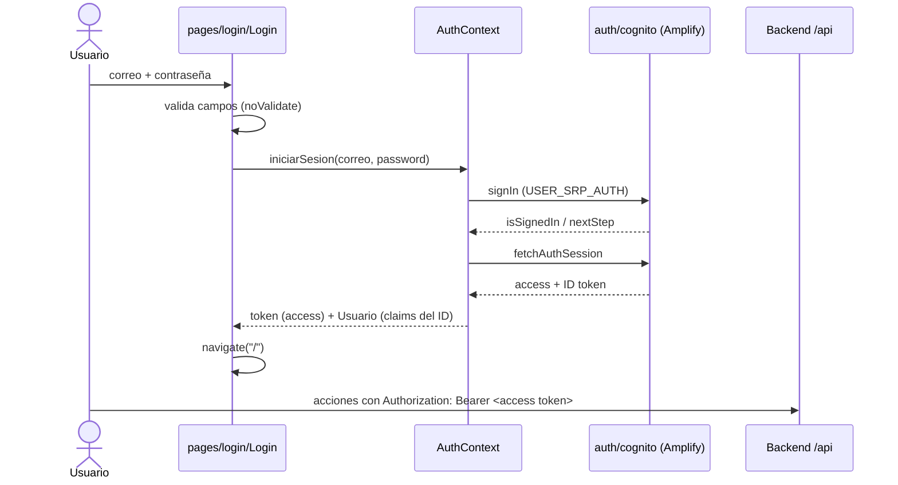

# ARQUITECTURA (documentación C4 del front SyncPass)

> **Corte:** 2026-11-17. **Alcance:** repositorio web `fullstack2-proyecto-kt` (Vite + React 19 + TypeScript + Wouter + AWS Amplify/Cognito).
> Este documento describe **lo que el código hace realmente**. El backend, Supabase, la app Android y AWS viven en otros repositorios/cuentas: cuando no hay evidencia aquí se marca como *no verificable en este repo*. No se afirma una URL productiva ni un despliegue de API Gateway que no conste en el código.

## Equivalencia con las capas de la rúbrica

La rúbrica describe capas Android/MVVM (`Datasource`, `Repository`, `Remote/Local`, `ViewModel`, `View`). En este repositorio **no hay app Android ni MVVM**: la equivalencia es conceptual y se documenta sin renombrar archivos:

| Capa de la rúbrica | Equivalente real en este repo | Ubicación |
|---|---|---|
| `View` / `Screen` | Páginas montadas por Wouter | `src/pages/**` |
| `Components` | Componentes clasificados (Atomic Design incremental) | `src/components/{atoms,molecules,organisms,templates}` |
| `ViewModel` / estado de UI | Contexto de sesión + hooks | `src/auth/AuthContext.tsx`, `src/pages/hooks/useDocumentTitle.ts` |
| `Repository` / `Datasource` remoto | Clientes HTTP tipados (`api`, **no** renombrado a `clients`) | `src/api/{client,registro,cursos,notifications}.ts` |
| `Datasource` local | Datos estáticos del catálogo de ejemplo | `src/data/cursos.ts` |
| Servicio de identidad | Cliente Cognito (Amplify) | `src/auth/cognito.ts` |
| Offline / Room / sincronización | **No presente** (backlog de la app Android, otro repo) | — |

Los nombres `api`, `auth` y `pages/hooks` se conservan: la tabla anterior es la correspondencia con la terminología de la rúbrica, no un plan de renombrado.

## C1 — Contexto del sistema



\* El despliegue y Supabase se mencionan en `docs/06`/`docs/07` y en los scripts de `scripts/`, pero **no se verifican desde este repositorio**. No se declara una URL productiva: `vite.config.ts` usa `base: '/'` y el workflow de Pages compila con `--base=/fullstack2-proyecto-kt/`.

**Interacciones C1**
- El usuario abre la SPA en el navegador; la SPA es estática (Vite build en `dist/`).
- La SPA habla con Cognito para **login** (Amplify SRP) y con el backend para **registro, confirmación, reenvío, cursos y notificaciones**.
- El backend valida el JWT y aplica la autorización real; la SPA solo oculta controles por rol.
- **API Gateway:** aparece solo como cambios sin commitear en el repo del backend (ver `docs/07-pendientes-registro.md`, T6/P6.5); **no está desplegado ni verificado** y no se dibuja como eslabón activo.

## C2 — Contenedores (topología real verificable)



Notas C2:
- En desarrollo, `vite.config.ts` hace proxy de `/api` a `http://localhost:8080`: **mismo origen**, sin CORS.
- `api/client.ts` construye la base desde `VITE_API_BASE_URL ?? '/api'`, adjunta `Content-Type` cuando hay cuerpo y `Authorization: Bearer <token>` cuando hay token. Los errores se normalizan en `ApiError` leyendo `data.error`.
- `cognito.ts` guarda en el contexto el **access token** (`accessToken.toString()`) y construye el `Usuario` desde los claims del **ID token** (`preferred_username` → `email` → `cognito:username` → `sub`; rol desde `cognito:groups`). El access token es el que acepta el backend (según `docs/07`).
- No se ha ejecutado ninguna llamada real a Cognito ni al backend desde este repo: las pruebas simulan `fetch` y los módulos de Amplify.

## C3 — Componentes (React)



### Capas de componentes (Atomic Design incremental)

| Nivel | Componentes | Responsabilidad |
|---|---|---|
| `atoms` | `Icon`, `Logo`, `Button`, `Input` | Piezas indivisibles sin estado de negocio. `Button`/`Input` son ejemplos de la guía 03 y no se usan en las páginas. |
| `molecules` | `Alerta`, `BotonEnvio`, `Card`, `PassCard` | Grupos simples; `Form.module.css` es compartido por `Alerta` y `BotonEnvio`. `Card` es ejemplo sin uso. |
| `organisms` | `Header`, `Footer`, `CursoForm`, `Menu` | Bloques con navegación, sesión o formularios completos. `Menu` es ejemplo sin uso. |
| `templates` | `AuthLayout`, `RequireAuth` | Estructura de pantalla (login/registro) y guard de ruta reutilizable. |

Cada componente conserva su CSS Module junto al `.tsx`. La clasificación **no cambió markup, estilos ni comportamiento**; los ejemplos sin uso se clasificaron, no se eliminaron.

### Tailwind de forma acotada

`src/tailwind.css` importa solo `theme` + `utilities` de Tailwind v4 (**sin preflight**, porque `src/index.css` ya define reset y tokens). Las utilidades quedan en capas, de modo que el CSS existente (sin capa) gana en caso de conflicto. Tailwind se usa **solo en `pages/not-found/NotFound.tsx`**; el resto sigue con CSS Modules y tokens (`var(--color-...)`).

## Flujos reales

### Login, restauración y Bearer



Restauración al recargar: `AuthProvider` ejecuta `obtenerSesion()` en un `useEffect`; con sesión válida guarda token/usuario y siempre marca `isReady = true` en `finally`. `RequireAuth` espera `isReady`, exige `isAuthenticated` y `token`, y redirige a `/login` (con `navigate('/login', {replace:true})`, respetando el `base` del `Router`). El parámetro `roles` es opcional; en `App.tsx` las rutas `/cursos` y `/notifications` se envuelven solo con la comprobación de sesión/token, por lo que el panel mantiene su mensaje de «Acceso denegado» para roles no administradores.

### Registro / confirmación / reenvío

```mermaid
sequenceDiagram
    actor U as Usuario
    participant R as pages/register/Register
    participant API as api/registro.ts
    participant B as Backend /api/auth/registro*

    U->>R: nombre, correo, teléfono, contraseña
    R->>R: valida teléfono E.164 y requisitos de contraseña
    R->>API: registrarUsuario({nombre,email,telefono,password})
    API->>B: POST /auth/registro (sin rol)
    B-->>R: 201
    R->>R: etapa "confirmar"
    U->>R: código de 6 dígitos
    R->>API: confirmarRegistro({email,codigo})
    API->>B: POST /auth/registro/confirmar
    B-->>R: 204 → etapa "listo" → /login
    optreenvio
      R->>API: reenviarCodigo({email})
      API->>B: POST /auth/registro/reenviar-codigo
    end
```

`/register?confirmar=1` abre directo la etapa de confirmación (lo usan el login y el pie de página).

### Cursos y notificaciones

Tras el guard, `Cursos` carga `listarCursos(token)` y ofrece detalle, creación, edición y desactivación; las acciones de administrador se ocultan para otros roles, pero **la autorización efectiva la aplica el backend**. `Notifications` exige rol `ADMINISTRADOR` en la UI, envía `enviarNotificacionManual({titulo,cuerpo,roles}, token)` y consulta `getHistorial(token)`.

**Historial:** el contrato real es `getHistorial(): Promise<unknown[]>`; el backend devuelve siempre `[]` y la UI muestra «Aún no hay notificaciones en el historial». **No se han inventado campos de historial**; presentar registros está en backlog (ver `ALCANCE.md`).

## Pruebas y evidencia

- `npm test` → Vitest (44 pruebas): 21 suites migradas de `node:test` (20 casos originales + cobertura de `reenviarCodigo`) y tests RTL de `CursoForm`, `Login`, `Notifications`, `RequireAuth`, `App`/404. Los tests unitarios usan entorno `node` y `fetch` simulado; los de componentes usan jsdom con mocks controlados, sin red ni Cognito real.
- `npm run test:coverage` → V8, salida `text`, `json-summary` y `lcov` en `coverage/`. Umbral global 30% en líneas, sentencias, funciones y ramas; resultado real: 44,56% líneas / 43,78% sentencias / 48,07% funciones / 47,88% ramas.
- `npm run lint` (oxlint) y `npm run build` (`tsc -b && vite build`) sin errores.
