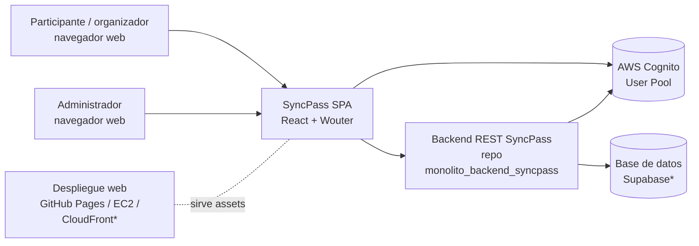
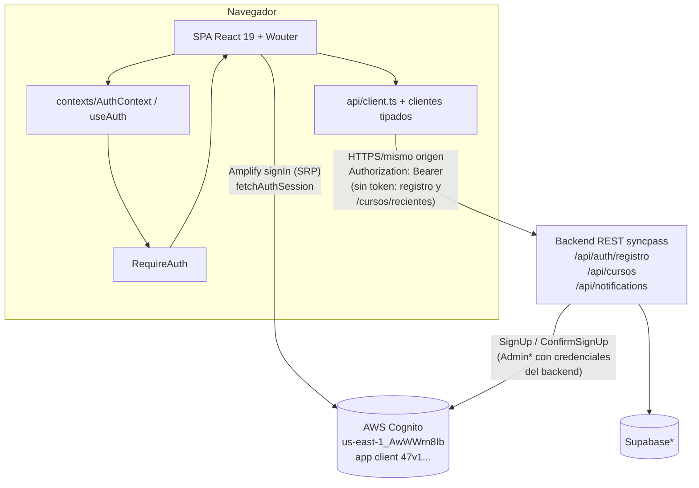
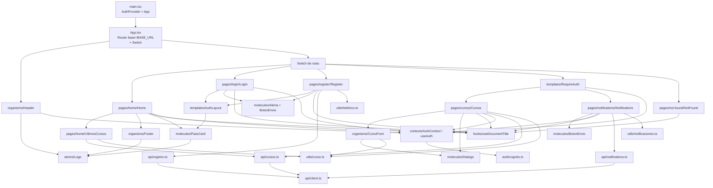
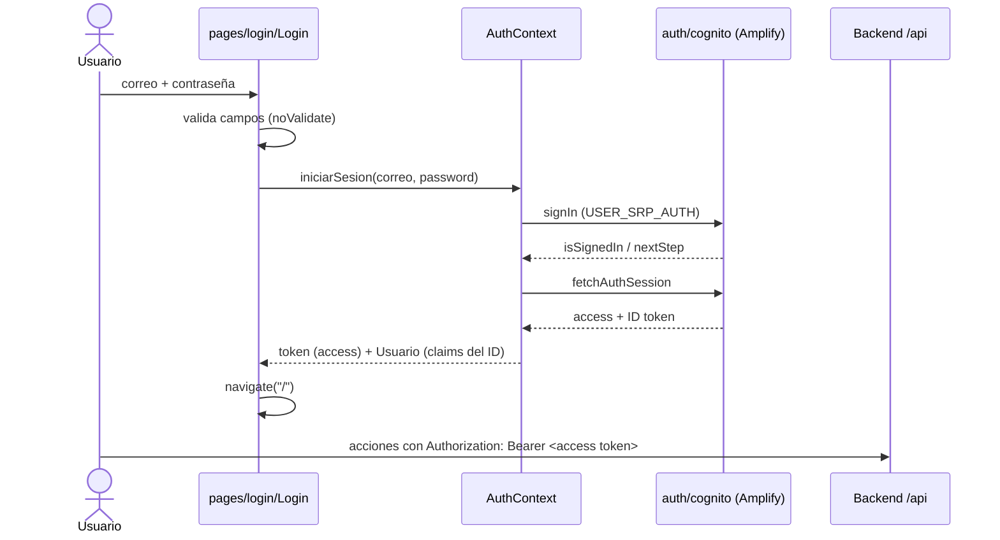
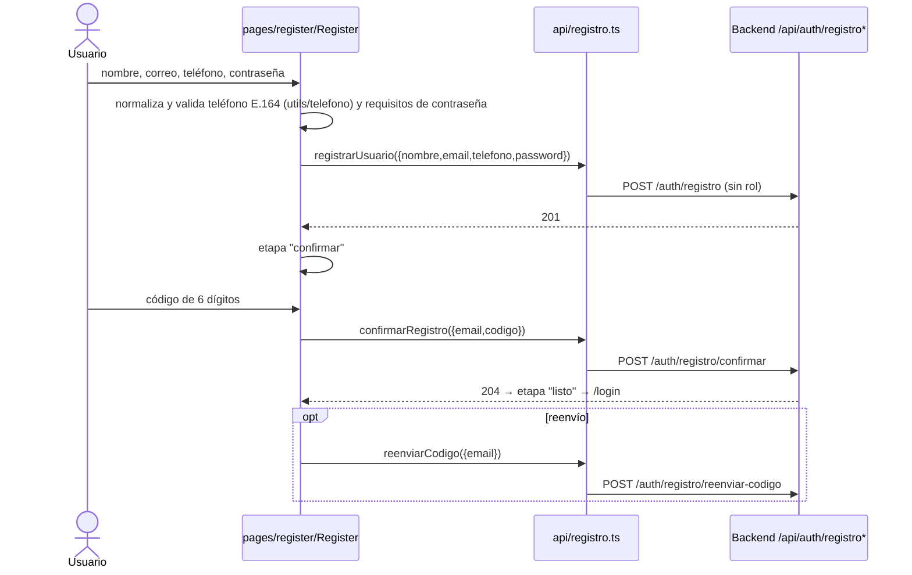
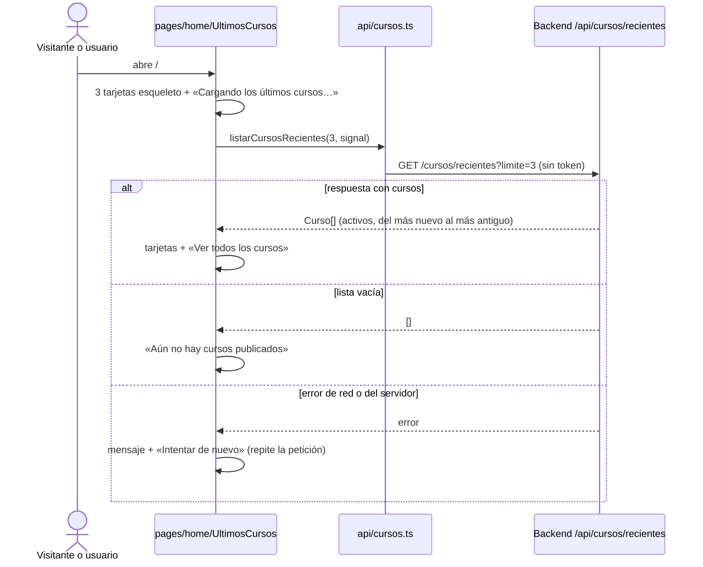

# ARQUITECTURA (documentación C4 del front SyncPass)

> **Corte:** 2026-11-19. **Alcance:** repositorio web `fullstack2-proyecto-kt` (Vite + React 19 + TypeScript + Wouter + Tailwind v4 + AWS Amplify/Cognito).
> Este documento describe **lo que el código hace realmente**. El backend, Supabase, la app Android y AWS viven en otros repositorios/cuentas: cuando no hay evidencia aquí se marca como *no verificable en este repo*. No se afirma una URL productiva ni un despliegue de API Gateway que no conste en el código.

## Arquitectura en capas (React)

La rúbrica pide capas como *hooks, contexts, clients, components, pages, utils*. Cada una tiene su carpeta en `src/`:

| Capa (rúbrica) | Carpeta real | Contenido |
|---|---|---|
| `pages` | `src/pages/**` | Vistas ruteadas con Wouter en `App.tsx`: `home/Home` (+ `home/UltimosCursos`), `login/Login`, `register/Register`, `cursos/Cursos`, `notifications/Notifications`, `not-found/NotFound` |
| `components` | `src/components/{atoms,molecules,organisms,templates}` | UI reutilizable clasificada con Atomic Design (ver C3) |
| `hooks` | `src/hooks/` | `useDocumentTitle.ts` (hook propio). `useAuth` se exporta junto al contexto |
| `contexts` | `src/contexts/` | `AuthContext.tsx`: `AuthProvider` + `useAuth` (token, usuario, `isReady`, `iniciarSesion`, `cerrarSesion`) |
| `clients` | `src/api/` (se conserva el nombre `api`) | `client.ts` (`apiRequest`, `ApiError`) y clientes tipados `registro.ts`, `cursos.ts`, `notifications.ts` |
| `utils` | `src/utils/` | Funciones puras, sin HTTP ni React: `curso.ts` (validación, fechas, duración, orden), `telefono.ts` (E.164), `notificaciones.ts` (formato del historial) |
| Servicio de identidad | `src/auth/` | `cognito.ts`: Amplify v6 (SRP), mensajes de error y claims → `Usuario` |

Dependencias: `pages` usa `components`, `hooks`, `contexts`, `api` y `utils`; `contexts` usa `auth`; los clientes de `api` usan `api/client.ts`. `utils` no depende de otras capas salvo **tipos** (`utils/curso.ts` importa `type Curso` de `api/cursos.ts`). `mensajeDeRegistro` se queda en `api/registro.ts` porque traduce el `ApiError` del cliente HTTP.

### Clientes HTTP con tipos de Request y Response

| Cliente | Request | Response |
|---|---|---|
| `api/client.ts` | `ApiRequestOptions` (`method`, `body`, `token`, `signal`) | `Promise<T>` genérico; errores como `ApiError` (`status` + mensaje) |
| `api/registro.ts` | `DatosRegistro`, `ConfirmarRegistroRequest`, `ReenviarCodigoRequest` | `UsuarioRegistrado`; confirmar/reenviar → `void` (204) |
| `api/cursos.ts` | `CursoCreateRequest`, `CursoUpdateRequest` (`Partial`) | `Curso` / `Curso[]` (`listarCursos`, `listarCursosRecientes`, `obtenerCurso`, `crearCurso`, `editarCurso`); `desactivarCurso` → `void` |
| `api/notifications.ts` | `ManualNotificationRequest` (`roles: Rol[]`) | `NotificationResponse`; `HistorialResponse` = `HistorialItem[]` |

Las respuestas de notificaciones se validan en tiempo de ejecución (`esNotificationResponse`, `esHistorialItem`): si el backend devuelve otra forma, el cliente lanza `ApiError(502)` en vez de propagar datos mal tipados.

### Equivalencia con las capas Android/MVVM de la rúbrica

La rúbrica también describe capas Android/MVVM (`Datasource`, `Repository`, `Remote/Local`, `ViewModel`, `View`). En este repositorio **no hay app Android ni MVVM**: la equivalencia es conceptual:

| Capa de la rúbrica | Equivalente real en este repo | Ubicación |
|---|---|---|
| `View` / `Screen` | Páginas montadas por Wouter | `src/pages/**` |
| `Components` | Componentes clasificados (Atomic Design incremental) | `src/components/{atoms,molecules,organisms,templates}` |
| `ViewModel` / estado de UI | Contexto de sesión + hooks | `src/contexts/AuthContext.tsx`, `src/hooks/useDocumentTitle.ts` |
| `Repository` / `Datasource` remoto | Clientes HTTP tipados (`api`, equivale a `clients`) | `src/api/{client,registro,cursos,notifications}.ts` |
| `Datasource` local | **No hay datos locales**: los cursos vienen del backend (`/api/cursos`, `/api/cursos/recientes`); Amplify guarda la sesión de Cognito en `localStorage` | — |
| Servicio de identidad | Cliente Cognito (Amplify) | `src/auth/cognito.ts` |
| Offline / Room / sincronización | **No presente** (backlog de la app Android, otro repo) | — |

El nombre `api` se conserva: equivale a la capa *clients* y no se renombra.

## C1 — Contexto del sistema

\* El despliegue y Supabase se mencionan en `docs/06`/`docs/07` y en los scripts de `scripts/`, pero **no se verifican desde este repositorio**. No se declara una URL productiva: `vite.config.ts` usa `base: '/'` y el workflow de Pages compila con `--base=/fullstack2-proyecto-kt/`.

**Interacciones C1**
- El usuario abre la SPA en el navegador; la SPA es estática (Vite build en `dist/`).
- La SPA habla con Cognito para **login** (Amplify SRP) y con el backend para **registro, confirmación, reenvío, cursos (incluido el listado público de recientes de la portada) y notificaciones**.
- El backend valida el JWT y aplica la autorización real; la SPA solo oculta controles por rol.
- **API Gateway:** aparece solo como cambios sin commitear en el repo del backend (ver `docs/07-pendientes-registro.md`, T6/P6.5); **no está desplegado ni verificado** y no se dibuja como eslabón activo.

## C2 — Contenedores (topología real verificable)

Notas C2:
- En desarrollo, `vite.config.ts` hace proxy de `/api` a `http://localhost:8080`: **mismo origen**, sin CORS.
- `api/client.ts` construye la base desde `VITE_API_BASE_URL ?? '/api'`, adjunta `Content-Type` cuando hay cuerpo y `Authorization: Bearer <token>` cuando hay token. Los errores se normalizan en `ApiError` leyendo `data.error`.
- `auth/cognito.ts` entrega a `contexts/AuthContext.tsx` el **access token** (`accessToken.toString()`), que el contexto guarda como `token`, y construye el `Usuario` desde los claims del **ID token** (`preferred_username` → `email` → `cognito:username` → `sub`; rol desde `cognito:groups`). El access token es el que acepta el backend (según `docs/07`).
- No se ha ejecutado ninguna llamada real a Cognito ni al backend desde este repo: las pruebas simulan `fetch` y los módulos de Amplify.

## C3 — Componentes (React)

### Capas de componentes (Atomic Design incremental)

| Nivel | Componentes | Responsabilidad |
|---|---|---|
| `atoms` | `Icon`, `Logo`, `Button`, `Input` | Piezas indivisibles sin estado de negocio. `Logo` usa Tailwind. `Button`/`Input` son ejemplos de la guía 03 y no se usan en las páginas. |
| `molecules` | `Alerta`, `BotonEnvio`, `Card`, `Dialogo`, `PassCard` | Grupos simples. `Alerta` y `Card` usan Tailwind; `Dialogo` envuelve el `<dialog>` nativo (detalle, desactivar y descartar cambios); `Form.module.css` lo comparten `BotonEnvio`, `Login` y `Register`. `Card` es ejemplo sin uso. |
| `organisms` | `Header`, `Footer`, `CursoForm`, `Menu` | Bloques con navegación, sesión o formularios completos. `Footer` usa Tailwind. `Menu` es ejemplo sin uso. |
| `templates` | `AuthLayout`, `RequireAuth` | Estructura de pantalla (login/registro) y guard de ruta reutilizable. `RequireAuth` usa Tailwind. |

Los componentes con CSS Module lo tienen junto al `.tsx`; los migrados a Tailwind (`Logo`, `Alerta`, `Card`, `Footer`, `RequireAuth`) ya no tienen CSS Module. La reclasificación por niveles **no cambió markup, estilos ni comportamiento**; los ejemplos sin uso se clasificaron, no se eliminaron.

### Tailwind de forma acotada

`src/tailwind.css` importa solo `theme` + `utilities` de Tailwind v4 (**sin preflight**, porque `src/index.css` ya define reset y tokens) y declara el orden de capas `@layer theme, base, utilities;` (el mismo que encabeza `index.css`):

- El reset de elementos de `index.css` (`h1`–`h4`, `p`, controles de formulario, `:focus-visible`) vive en `@layer base`, **por debajo de las utilidades**, como haría el preflight. Así `mt-4` o `text-white` pueden ajustar un `
` o un `<h2>`. (Antes ese reset no tenía capa y anulaba, por ejemplo, los márgenes `mt-*` de los textos de la 404.)
- Los tokens (`:root`), `.container`, `.sr-only`, `.saltar-contenido` y los **CSS Modules** siguen sin capa y ganan cualquier conflicto. Por eso, al migrar un componente, se borra su regla del CSS Module; y por eso `.container` de `index.css` prevalece sobre la utilidad `container` que Tailwind genera al encontrar esa clase.
- `@theme` agrega `--animate-aparecer` y `@keyframes aparecer` (usa los tokens `--duracion` y `--curva-salida`) para la entrada de `Alerta`.

Dónde se usa:

| Nivel | Archivo | Uso |
|---|---|---|
| atom | `components/atoms/Logo.tsx` | Tipografía y color según `claro`; relleno del isotipo con `fill-[var(--color-primario)]` |
| molecule | `components/molecules/Alerta.tsx` | Tonos error/éxito elegidos por prop (`--color-error*`, `--color-exito*`), `animate-aparecer` |
| molecule | `components/molecules/Card.tsx` | Ejemplo de la guía 03 (sin uso en páginas), mismos valores que su CSS anterior |
| organism | `components/organisms/Footer.tsx` | Grilla responsive (`grid-cols-[1fr_1fr]`, `md:grid-cols-[2fr_1fr_1fr]`, `max-md:col-span-full`), `hover:`/`focus-visible:` en los enlaces |
| template | `components/templates/RequireAuth.tsx` | Estados «Verificando la sesión…» / «Redirigiendo…» centrados |
| page | `pages/not-found/NotFound.tsx` | Vista 404 completa |
| page | `pages/notifications/Notifications.tsx` | Solo la lista del historial (el resto de la página usa su CSS Module) |

Convención: los colores, radios y sombras salen de los tokens de `index.css` con valores arbitrarios (`bg-[var(--color-...)]`, `text-[var(--color-...)]`, `rounded-[var(--radio-md)]`); en `border` y `outline` se indica el tipo (`border-[color:var(--...)]`, `outline-[color:var(--...)]`) porque con `var()` Tailwind no puede distinguir ancho de color. El resto de la app (`Header`, `Home`, `UltimosCursos`, `Login`, `Register`, `Cursos`, `CursoForm`, `Dialogo`, `PassCard`, `AuthLayout`, `BotonEnvio`) sigue con CSS Modules y los mismos tokens.

## Flujos reales

### Login, restauración y Bearer

Restauración al recargar: `AuthProvider` ejecuta `obtenerSesion()` en un `useEffect`; con sesión válida guarda token/usuario y siempre marca `isReady = true` en `finally`. `RequireAuth` espera `isReady`, exige `isAuthenticated` y `token`, y redirige a `/login` (con `navigate('/login', {replace:true})`, respetando el `base` del `Router`). El parámetro `roles` es opcional; en `App.tsx` las rutas `/cursos` y `/notifications` se envuelven solo con la comprobación de sesión/token, por lo que el panel mantiene su mensaje de «Acceso denegado» para roles no administradores.

### Registro / confirmación / reenvío

`/register?confirmar=1` abre directo la etapa de confirmación (lo usan el login y el pie de página).

### Últimos cursos en la portada

El endpoint es público: el backend acota `limite` entre 1 y 12 y excluye los cursos `FINALIZADO`. Si el usuario sale de la portada antes de la respuesta, el `AbortController` cancela la petición. El botón de cada tarjeta depende de la sesión: «Inscribirme» (visitante → `/register`) o «Ver detalles» (autenticado → `/cursos`).

### Cursos y notificaciones

Tras el guard, `Cursos` carga `listarCursos(token)`. Todos los roles ven la tabla y el **diálogo de detalle**; el administrador además crea y edita con `CursoForm` (se descarga aparte con `React.lazy`) y desactiva tras confirmar en un **diálogo** (`molecules/Dialogo`, `<dialog>` nativo). Las acciones de administrador se ocultan para otros roles, pero **la autorización efectiva la aplica el backend**. El formulario valida con `validarCurso` (`utils/curso.ts`) las mismas reglas que el backend; entre ellas, **la fecha de término debe ser igual o posterior a la de inicio** (el calendario de término usa `min`, el error aparece apenas ambas fechas están elegidas y el envío se bloquea; el backend responde 400 si llegara una fecha invertida).

`Notifications` exige rol `ADMINISTRADOR` en la UI, envía `enviarNotificacionManual({titulo,cuerpo,roles}, token)` y consulta `getHistorial(token)`.

**Historial:** `getHistorial(token): Promise<HistorialResponse>` (`HistorialItem[]`). `HistorialItem` copia el record `HistorialItem` de `NotificationController` en el backend: `id`, `titulo`, `cuerpo`, `roles` (vacío o `null` = todos los usuarios activos), `enviadoEn` (`LocalDateTime` sin zona) y `dispositivosEnviados`. El cliente valida cada registro y lanza `ApiError(502)` si no cumple el contrato. La UI muestra cada envío con fecha y hora (`utils/notificaciones.ts`), destinatarios y dispositivos. **El backend hoy devuelve siempre `[]`** (no hay tabla de historial), así que en uso real se ve «Aún no hay notificaciones en el historial»; la lista se prueba con datos simulados.

## Pruebas y evidencia

- `npm test` → Vitest, **84 pruebas en 16 archivos**: 39 unitarias en entorno `node` con `fetch` simulado (`auth`, `cognito`, `cursos`, `registro`, `notifications`, `curso-validacion`, `telefono`, `notificaciones-formato`) y 45 de componentes con jsdom + React Testing Library (`app`/404, `login`, `require-auth`, `curso-form`, `cursos-page`, `ultimos-cursos`, `notifications-page`, `componentes-tailwind`). Los mocks son controlados: sin red ni Cognito real.
- `npm run test:coverage` → V8, salida `text`, `json-summary` y `lcov` en `coverage/`. Umbral global 30% en líneas, sentencias, funciones y ramas; resultado real: 65,44% líneas / 64,54% sentencias / 65,56% funciones / 68,07% ramas.
- `npm run lint` (oxlint) y `npm run build` (`tsc -b && vite build`) sin errores.
