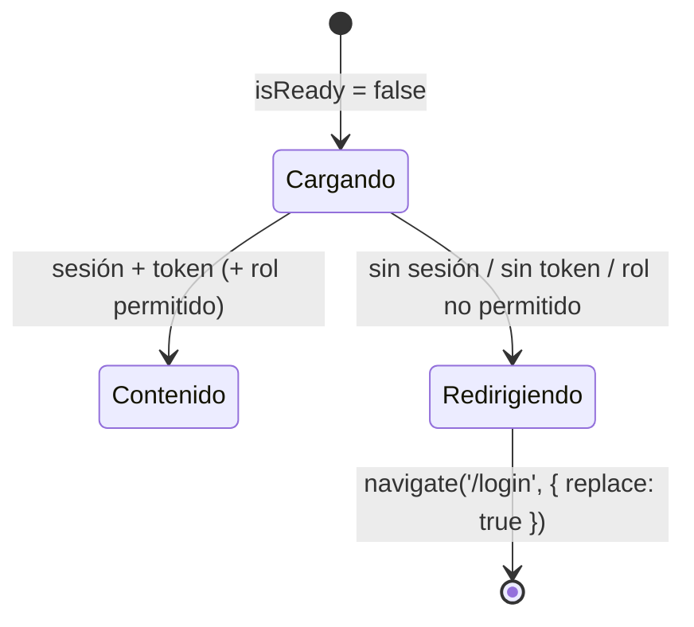

# MOCKUPS — vistas y estados (trazabilidad)

> **Corte:** 2026-11-19. Los wireframes representan la estructura real de `src/pages` y `src/components`, no un rediseño. Los estados se prueban con RTL en `tests/*.test.tsx` salvo donde se indica. Al final hay una tabla de trazabilidad con lo implementado y lo que sigue en backlog.

## Home — `/` (pública)

```text
┌──────────────────────────────────────────────────────────────────┐
│ Header: [Logo] Inicio · Cursos · Cómo funciona · Preguntas       │
│   visitante:   [Iniciar sesión] [Crear cuenta]                   │
│   autenticado: + «Cursos» (ADMINISTRADOR: «Gestión de cursos»    │
│                y «Notificaciones») · [A] Nombre [Cerrar sesión]  │
├──────────────────────────────────────────────────────────────────┤
│ Portada                                                          │
│  [QR] Inscripción y acreditación con QR                          │
│  H1: De tu curso a la acreditación en minutos.                   │
│  Bajada + [Ver los cursos →] (#cursos)  [Crear cuenta gratis]*   │
│  ✔ Inscripción online ✔ Código QR personal ✔ Funciona sin conexión│
│                       [PassCard] «Inscripción confirmada»        │
│                                  «Listo para escanear»           │
├──────────────────────────────────────────────────────────────────┤
│ Una plataforma, dos lados                                        │
│ H2: Pensado para quien asiste y para quien organiza              │
│ [Para participantes ✔✔✔]        [Para organizadores ✔✔✔]         │
├──────────────────────────────────────────────────────────────────┤
│ #cursos · Nuevos cursos                                          │
│ H2: Los últimos cursos publicados                                │
│ «Cada curso se acredita con código QR al momento de llegar.»     │
│ <UltimosCursos>  ← GET /api/cursos/recientes?limite=3 (público)  │
│ ┌────────────────┐ ┌────────────────┐ ┌────────────────┐         │
│ │ [portada 📖]   │ │ [portada 📅]   │ │ [portada ≋]    │         │
│ │ Área · Estado  │ │ …              │ │ …              │         │
│ │ H3: Título     │ │                │ │                │         │
│ │ Descripción    │ │                │ │                │         │
│ │ 📅 1 mar 2027 – 28 mar 2027  28 días (≈ 4 semanas)   │         │
│ │ 📍 UV 03       │ │                │ │                │         │
│ │ [Inscribirme]  │ visitante → /register                         │
│ │ [Ver detalles] │ autenticado → /cursos                         │
│ └────────────────┘ └────────────────┘ └────────────────┘         │
│                    [Ver todos los cursos →] (/cursos)            │
├──────────────────────────────────────────────────────────────────┤
│ #como-funciona · H2: De la inscripción al QR en tres pasos       │
│ Paso 1 Registra tu curso · Paso 2 Genera el código QR ·          │
│ Paso 3 Escanea y acredita                                        │
├──────────────────────────────────────────────────────────────────┤
│ #preguntas · H2: ¿Tienes dudas?   ▸ ¿Cómo creo mi cuenta? (+2)   │
├──────────────────────────────────────────────────────────────────┤
│ Banda: ¿Tu curso necesita acreditación QR? [Regístrate gratis →]*│
├──────────────────────────────────────────────────────────────────┤
│ Footer: [Logo] descripción | Plataforma | Tu cuenta | © SyncPass │
└──────────────────────────────────────────────────────────────────┘
```
\* Con sesión iniciada no se muestra «Crear cuenta gratis» y la banda final cambia a «Ver los cursos».

### Últimos cursos — estados (`pages/home/UltimosCursos.tsx`)

La sección llama a `listarCursosRecientes(3, signal)` → `GET /api/cursos/recientes?limite=3` **sin token** (endpoint público). El backend devuelve los cursos activos (no `FINALIZADO`) del más nuevo al más antiguo. Si el usuario sale de la portada antes de la respuesta, la petición se cancela (`AbortController`).

```text
Cargando: 3 tarjetas esqueleto del mismo tamaño (aria-hidden, la página no salta)
          + «Cargando los últimos cursos…» (role=status, solo lector de pantalla)
Lista:    hasta 3 tarjetas (portada ilustrada, área, estado, título, descripción,
          periodo + duración, unidad vecinal, CTA) + [Ver todos los cursos →]
Vacío:    [📖] «Aún no hay cursos publicados. ¡Vuelve pronto!»  (sin «Ver todos»)
Error:    [sin conexión] «No pudimos cargar los cursos en este momento.»
          [Intentar de nuevo]  (role=alert; vuelve a pedir los cursos)
```

## Login — `/login`

```text
┌──────────────────────────┬────────────────────────────────┐
│ Panel de marca           │ H1: Hola de nuevo              │
│ "Tu curso, verificado…"  │ Ingresa con tu correo y…       │
│ [PassCard]               │ [Alerta de error]*             │
│ ✔ Inscríbete…            │ Correo: [ 📧 input ]           │
│ ✔ Código QR personal     │ Contraseña: [ 🔒 input ][👁]   │
│ ✔ Acredita asistencia    │ [Iniciar sesión →]             │
│                          │ ¿Primera vez? [Crea tu cuenta] │
│                          │ ¿No confirmaste? [Confirmar]   │
└──────────────────────────┴────────────────────────────────┘
```
Estados: **formulario**, **validación** (mensajes bajo cada campo y foco en el primero), **error de auth** (`Alerta` + enlace «Confirmar mi cuenta» si `UserNotConfirmedException`), **sesión iniciada**:

```text
┌─────────────────────────────────────────────────┐
│ ✔  H1: Ya iniciaste sesión                      │
│    Estás conectado como <nombre>                │
│    [Ir al inicio →] [Cerrar sesión]             │
└─────────────────────────────────────────────────┘
```

## Registro — `/register` y `/register?confirmar=1`

```text
[① Tus datos] ── [② Verifica tu correo] ── [③ Listo]

Etapa "formulario":
  H1: Crea tu cuenta
  Nombre completo | Correo electrónico | Teléfono
  Contraseña | Confirmar contraseña [👁]
  Medidor: Seguridad: <nivel>  ✔ 8 caracteres ✔ Mayúscula…
  [Crear cuenta →]
  ¿Ya tienes cuenta? [Inicia sesión]
  ¿Tienes un código? [Confirma tu cuenta]

Etapa "confirmar":
  H1: Verifica tu correo
  "Enviamos un código de 6 dígitos a <correo>" (o campo Correo)
  Código de verificación: [ 000000 ]
  [Confirmar cuenta →]  [Enviar otro código] [Volver al registro]

Etapa "listo":
  ✔ H1: ¡Todo listo, <nombre>!
  Tu cuenta está confirmada. Ahora inicia sesión.
  [Ir a iniciar sesión →]
```
Estados adicionales: error del servidor en `Alerta`, aviso de reenvío en `Alerta tipo="exito"`, errores por campo con `aria-invalid`. El teléfono se normaliza a E.164 con `utils/telefono.ts` antes de validar y enviar.

## Cursos — `/cursos` (protegido)

```text
Acceso: RequireAuth → «Verificando la sesión…» / sin sesión: redirección a /login

┌──────────────────────────────────────────────────────────────────┐
│ SyncPass · Administración                                        │
│ H1: Gestión de cursos                           [+ Nuevo curso]* │
│ admin: «Crea, edita y desactiva los cursos de la comunidad.»     │
│ otros: «Consulta los cursos activos y sus detalles.»             │
├──────────────────────────────────────────────────────────────────┤
│ ✔ Se creó el curso «X».                                     [✕]  │ aviso (role=status, 4 s,
├──────────────────────────────────────────────────────────────────┤  la fila queda resaltada)
│ <CursoForm> en línea (solo admin; se descarga al abrirlo:        │
│  «Cargando formulario…»)                                         │
├──────────────────────────────────────────────────────────────────┤
│ H2: Cursos activos  [N cursos]                    [⟳ Actualizar] │
│ Curso        | Área     | Unidad | Periodo          | Estado     │
│ Huertos urb. | Medio a. | UV 03  | 1 mar – 28 mar   | Planificado│
│  Cultivo en… |          |        | 28 días (≈ 4 sem)|            │
│                          [👁 Ver] [✎ Editar]* [Desactivar]*      │
└──────────────────────────────────────────────────────────────────┘
* solo ADMINISTRADOR (la autorización real la aplica el backend)
```
Estados del listado: **cargando** (tabla esqueleto + «Cargando cursos…»), **error** (mensaje del backend + [Reintentar]), **vacío** (admin: «Aún no hay cursos activos» + [+ Crear el primer curso]; otros roles: «Cuando se publiquen cursos aparecerán aquí.»), **tabla** ordenada por fecha de inicio.

### Formulario de curso (`organisms/CursoForm.tsx`)

```text
┌─ [📖] H2: Nuevo curso | Editar curso ──────────────────────────────┐
│ «Completa los datos del curso…» | «Estás editando <título>.»       │
│ ⚠ Revisa N campos antes de guardar   (tras enviar con errores;     │
│   cada error es un botón que lleva el foco al campo)               │
│ Información general                                                │
│   Título* ...................................... 0/150            │
│   Descripción (opcional) ....................... 0/1000           │
│ Clasificación                                                      │
│   Área temática* [sugerencias]  Unidad vecinal* [sugerencias]      │
│   Estado* ▾ (nuevo: Planificado / En curso · edición: + Finalizado)│
│ Periodo                                                            │
│   Fecha de inicio* [📅]     Fecha de término* [📅  min = inicio]   │
│   ayuda: «Igual o posterior al 1 de marzo de 2027.»                │
│   error: «La fecha de término no puede ser anterior al inicio      │
│           (1 de marzo de 2027).»                                   │
│   📅 Duración: 28 días (≈ 4 semanas)                               │
│ ⚠ <error del servidor>                                             │
│ * Campos obligatorios        [Cancelar] [✔ Crear curso |           │
│                                         Guardar cambios | Guardando…]│
└────────────────────────────────────────────────────────────────────┘
```
**Validación término ≥ inicio** (el mismo día es válido: duración «1 día»): el calendario de término no ofrece días anteriores (`min`), `validarCurso` (`src/utils/curso.ts`) muestra el error apenas ambas fechas están elegidas y bloquea el envío, y el backend repite la regla (`400`). Los demás campos se validan al salir de ellos o al intentar guardar.

### Diálogos (`molecules/Dialogo.tsx`, `<dialog>` nativo)

Atrapan el foco, cierran con Esc, con clic en el fondo o con [✕] y devuelven el foco al botón que los abrió.

```text
Detalle (todos los roles):              Desactivar (admin, tono peligro):
┌ H2: <título del curso>        [✕] ┐   ┌ H2: ¿Desactivar este curso?    [✕] ┐
│ Descripción / «Sin descripción»   │   │ «X» pasará a Finalizado y dejará   │
│ Estado [badge]  Duración: N días  │   │ de aparecer en el listado de       │
│ Área temática   Unidad vecinal    │   │ cursos activos.                    │
│ Inicio y Término (fecha larga)    │   │ Sus eventos, inscripciones y       │
│        [Cerrar] [✎ Editar curso]* │   │ asistencias se conservan.          │
└───────────────────────────────────┘   │ ⚠ <error del backend>              │
                                         │ [Cancelar] [Desactivar|Desactivando…]│
                                         └────────────────────────────────────┘
                                         (no se puede cerrar mientras desactiva)

Descartar cambios (al cancelar el formulario con cambios):
┌ H2: ¿Descartar los cambios?                [✕] ┐
│ Lo que escribiste en el formulario se perderá. │
│ [Seguir editando] [Descartar]                  │
└────────────────────────────────────────────────┘
```

## Notificaciones — `/notifications` (protegido)

```text
Carga:      "Verificando la sesión…"
Visitante:  Redirección a /login por RequireAuth
No admin:
┌────────────────────────────────────────────┐
│ H1: Acceso denegado                        │
│ No tienes permisos para administrar…       │
│ [Volver al inicio]                         │
└────────────────────────────────────────────┘

Administrador:
┌───────────────────────────┬──────────────────────────────────┐
│ Enviar notificación       │ Historial                        │
│ Título: [          ]      │ "Las notificaciones…"            │
│ Cuerpo: [ textarea ]      │ Cargando… / Aún no hay… / error  │
│ Roles destino:            │ ┌ H3: Recordatorio de evento ──┐ │
│ ☐ ADMINISTRADOR ☐ COOR…   │ │ El curso empieza el lunes    │ │
│ ☐ VOLUNTARIO ☐ BENEFICI…  │ │ 13 nov 2026, 22:00 ·         │ │
│ [Enviar notificación →]   │ │ Para: VOLUNTARIO · 12 disp.  │ │
│                           │ └──────────────────────────────┘ │
└───────────────────────────┴──────────────────────────────────┘
```
El historial usa el contrato tipado `HistorialItem` (`id`, `titulo`, `cuerpo`, `roles`, `enviadoEn`, `dispositivosEnviados`), igual al record del backend; con `roles` vacío o `null` se muestra «Para: Todos los usuarios activos». **El backend real devuelve siempre `[]`** (no hay tabla de historial), así que el estado visible hoy es «Aún no hay notificaciones en el historial»; la lista se prueba con datos simulados. Errores de validación/envío/historial en `role="alert"`, éxito en `role="status"`.

## 404 — cualquier ruta desconocida

```text
┌────────────────────────────────────────────┐
│        [🎫]                                │
│        ERROR 404                           │
│  H1: No encontramos esta página            │
│  Puede que el enlace esté incompleto…      │
│  [← Volver al inicio]                      │
└────────────────────────────────────────────┘
```
Primera vista migrada a Tailwind; usa los tokens `var(--color-...)`.

## RequireAuth — estados del guard (sin vista propia)



```text
Cargando:     <main id="contenido"> "Verificando la sesión…" (role=status)
Redirigiendo: <main id="contenido"> "Redirigiendo al inicio de sesión…"
Autenticado:  renderiza los hijos (página protegida)
```

## Componentes con Tailwind visibles en las vistas

`Logo` (encabezado, pie y pase), `Footer` (Home), `Alerta` (Login y Registro), los estados de `RequireAuth`, la lista del historial de Notificaciones y la 404. El resto de las vistas sigue con CSS Modules. Detalle en [ARQUITECTURA.md](./ARQUITECTURA.md#tailwind-de-forma-acotada).

## Trazabilidad mockup → ruta → archivo → estado → evidencia

| Mockup | Ruta | Archivo | Estado | Test / evidencia |
|---|---|---|---|---|
| Home · portada y secciones | `/` | `src/pages/home/Home.tsx` | Implementado (visitante/autenticado) | `tests/app.test.tsx` |
| Home · últimos cursos (cargando / lista / vacío / error y reintento) | `/` (`#cursos`) | `src/pages/home/UltimosCursos.tsx`, `src/api/cursos.ts` (`listarCursosRecientes`) | Implementado | `tests/ultimos-cursos.test.tsx`, `tests/cursos.test.ts` (endpoint público sin token) |
| Home · pie de página | `/` | `src/components/organisms/Footer.tsx` | Implementado (Tailwind) | `tests/componentes-tailwind.test.tsx` |
| Login · formulario | `/login` | `src/pages/login/Login.tsx` | Implementado | `tests/login.test.tsx` |
| Login · validación | `/login` | `src/pages/login/Login.tsx` | Implementado | `tests/login.test.tsx` |
| Login · error no confirmado | `/login` | `src/pages/login/Login.tsx`, `src/components/molecules/Alerta.tsx` | Implementado (Alerta con Tailwind) | `tests/login.test.tsx`, `tests/componentes-tailwind.test.tsx` |
| Login · sesión iniciada | `/login` | `src/pages/login/Login.tsx` | Implementado | `tests/login.test.tsx` |
| Registro · formulario | `/register` | `src/pages/register/Register.tsx`, `src/utils/telefono.ts` | Implementado | `tests/registro.test.ts` (API), `tests/telefono.test.ts` |
| Registro · confirmar | `/register?confirmar=1` | `src/pages/register/Register.tsx` | Implementado | `tests/registro.test.ts` (API) |
| Registro · listo | `/register` (interno) | `src/pages/register/Register.tsx` | Implementado | Sin test RTL dedicado (backlog de evidencia) |
| Cursos · carga/acceso | `/cursos` | `src/pages/cursos/Cursos.tsx`, `src/components/templates/RequireAuth.tsx` | Implementado | `tests/require-auth.test.tsx` |
| Cursos · listado (cargando / error / vacío / tabla) y acciones por rol | `/cursos` | `src/pages/cursos/Cursos.tsx` | Implementado | `tests/cursos-page.test.tsx`, `tests/cursos.test.ts` (API) |
| Cursos · diálogo de detalle | `/cursos` | `src/pages/cursos/Cursos.tsx`, `src/components/molecules/Dialogo.tsx` | Implementado | `tests/cursos-page.test.tsx` |
| Cursos · crear (formulario + aviso) | `/cursos` | `src/components/organisms/CursoForm.tsx` | Implementado | `tests/cursos-page.test.tsx`, `tests/curso-form.test.tsx` |
| Cursos · editar | `/cursos` | `src/components/organisms/CursoForm.tsx` | Implementado | `tests/curso-form.test.tsx` (precarga), `tests/cursos.test.ts` (PUT) |
| Cursos · validación término ≥ inicio | `/cursos` | `src/utils/curso.ts` (`validarCurso`), `src/components/organisms/CursoForm.tsx` | Implementado (también en backend) | `tests/curso-validacion.test.ts`, `tests/curso-form.test.tsx` |
| Cursos · descartar cambios | `/cursos` | `src/components/organisms/CursoForm.tsx`, `src/components/molecules/Dialogo.tsx` | Implementado | `tests/curso-form.test.tsx` |
| Cursos · desactivar (diálogo de confirmación) | `/cursos` | `src/pages/cursos/Cursos.tsx`, `src/components/molecules/Dialogo.tsx` | Implementado | `tests/cursos-page.test.tsx`, `tests/cursos.test.ts` (PATCH) |
| Notificaciones · carga/visitante/no admin/admin | `/notifications` | `src/pages/notifications/Notifications.tsx` | Implementado | `tests/notifications-page.test.tsx` |
| Notificaciones · historial (vacío / lista tipada / error) | `/notifications` | `src/pages/notifications/Notifications.tsx`, `src/api/notifications.ts` (`HistorialItem`), `src/utils/notificaciones.ts` | Parcial: UI y contrato tipado listos; el backend devuelve siempre `[]` | `tests/notifications.test.ts`, `tests/notifications-page.test.tsx`, `tests/notificaciones-formato.test.ts` |
| Acceso denegado | `/notifications` | `src/pages/notifications/Notifications.tsx` | Implementado | `tests/notifications-page.test.tsx` |
| 404 | `*` | `src/pages/not-found/NotFound.tsx` | Implementado (Tailwind) | `tests/app.test.tsx` |
| Guard · carga/redirección/contenido/rol | rutas protegidas | `src/components/templates/RequireAuth.tsx` | Implementado (Tailwind) | `tests/require-auth.test.tsx` |
| Recuperar contraseña | — | — | Backlog (sin vista) | — (`ALCANCE.md`, backlog 2) |
| Administración de usuarios y roles | — | — | Backlog (sin vista) | — (`ALCANCE.md`, backlog 2) |
| Inscripción a un curso y pase QR del participante | — | — (`PassCard` es solo ilustrativo; «Inscribirme» lleva a `/register`) | Backlog (sin vista) | — (`ALCANCE.md`, backlog 3) |
| Escaneo y acreditación de asistencia | — | — | Backlog / app Android (otro repo) | — (`ALCANCE.md`, backlog 6) |

Evidencia global: `npm run test:coverage` → `coverage/lcov-report/index.html`, `coverage/coverage-summary.json`.
