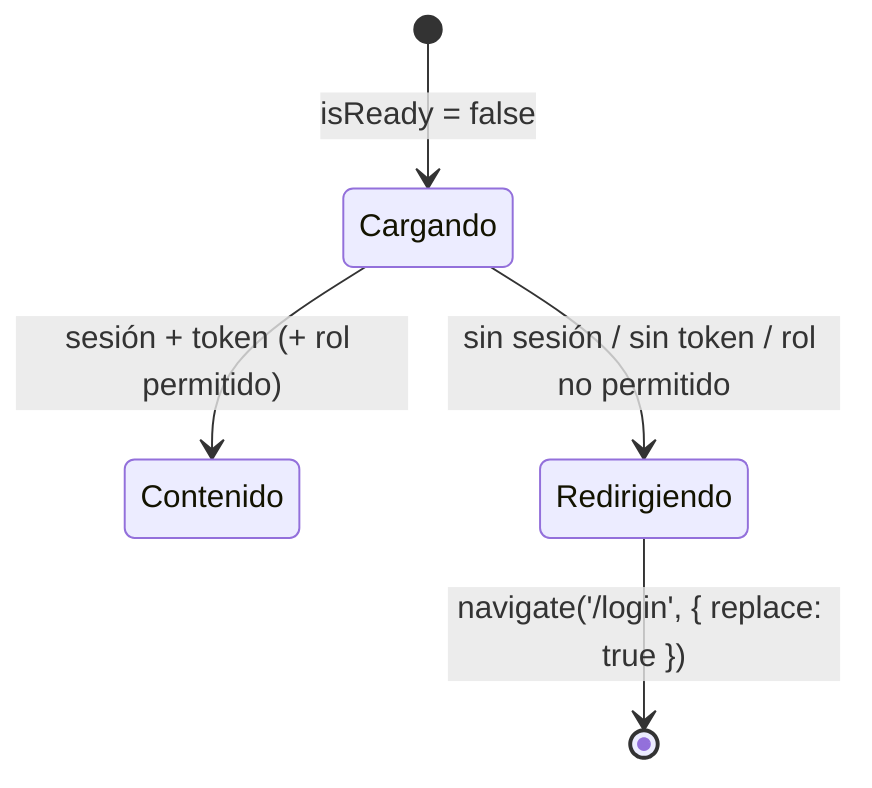

# MOCKUPS — vistas y estados (trazabilidad)

> **Corte:** 2026-11-17. Los wireframes representan la estructura real de `src/pages` y `src/components`, no un rediseño. Los estados se prueban con RTL en `tests/*.test.tsx` salvo donde se indica.

## Home — `/` (pública)

```text
┌───────────────────────────────────────────────────────────┐
│ Header: [Logo] Inicio · Cursos · Cómo funciona · Preguntas│
│         visitante: [Iniciar sesión] [Crear cuenta]        │
│         autenticado: [avatar] Nombre [Cerrar sesión]      │
├───────────────────────────────────────────────────────────┤
│ etiqueta: Inscripción y acreditación con QR               │
│ H1: De tu curso a la acreditación en minutos.             │
│ Bajada + [Ver los cursos] [Crear cuenta gratis]*          │
│ ✔ Inscripción online  ✔ Código QR personal  ✔ Sin conexión│
│                                       [PassCard / QR]     │
├───────────────────────────────────────────────────────────┤
│ Para participantes | Para organizadores                   │
│ Catálogo (#cursos) | Cómo funciona (#como-funciona)        │
│ Preguntas (#preguntas) | Banda final [Regístrate gratis]* │
├───────────────────────────────────────────────────────────┤
│ Footer: plataforma / tu cuenta / © SyncPass               │
└───────────────────────────────────────────────────────────┘
```
\* El CTA cambia a «Ver los cursos» cuando `isAuthenticated === true`.

## Login — `/login`

```text
┌──────────────────────────┬────────────────────────────────┐
│ Panel de marca           │ H1: Hola de nuevo              │
│ "Tu curso, verificado…"  │ Ingresa con tu correo y…       │
│ [PassCard]               │ [Alerta de error]*             │
│ ✔ Inscríbete…            │ Correo: [ 📧 input ]           │
│ ✔ Código QR personal     │ Contraseña: [ 🔒 input ][👁]   │
│ ✔ Acredita asistencia    │ [Iniciar sesión →]             │
│                          │ ¿Primera vez? [Crea tu cuenta] │
│                          │ ¿No confirmaste? [Confirmar]   │
└──────────────────────────┴────────────────────────────────┘
```
Estados: **formulario**, **validación** (mensajes bajo cada campo y foco en el primero), **error de auth** ( Alerta + enlace «Confirmar mi cuenta» si `UserNotConfirmedException`), **sesión iniciada**:

```text
┌─────────────────────────────────────────────────┐
│ ✔  H1: Ya iniciaste sesión                      │
│    Estás conectado como <nombre>                │
│    [Ir al inicio →] [Cerrar sesión]             │
└─────────────────────────────────────────────────┘
```

## Registro — `/register` y `/register?confirmar=1`

```text
[① Tus datos] ── [② Verifica tu correo] ── [③ Listo]

Etapa "formulario":
  H1: Crea tu cuenta
  Nombre completo | Correo electrónico | Teléfono
  Contraseña | Confirmar contraseña [👁]
  Medidor: Seguridad: <nivel>  ✔ 8 caracteres ✔ Mayúscula…
  [Crear cuenta →]
  ¿Ya tienes cuenta? [Inicia sesión]
  ¿Tienes un código? [Confirma tu cuenta]

Etapa "confirmar":
  H1: Verifica tu correo
  "Enviamos un código de 6 dígitos a <correo>" (o campo Correo)
  Código de verificación: [ 000000 ]
  [Confirmar cuenta →]  [Enviar otro código] [Volver al registro]

Etapa "listo":
  ✔ H1: ¡Todo listo, <nombre>!
  Tu cuenta está confirmada. Ahora inicia sesión.
  [Ir a iniciar sesión →]
```
Estados adicionales: error del servidor en `Alerta`, aviso de reenvío en `Alerta tipo="exito"`, errores por campo con `aria-invalid`.

## Cursos — `/cursos` (protegido)

```text
Carga:      "Verificando la sesión…" (RequireAuth) / "Cargando cursos…"
Sin sesión: Redirección automática a /login por RequireAuth

Autenticado (no admin):
┌──────────────────────────────────────────────────────────┐
│ SyncPass · Administración / H1: Gestión de cursos        │
│ Cursos activos [Actualizar lista]                        │
│ Título | Área | Unidad | Fechas | Estado | Detalle        │
│ ... [Ver detalle] → panel "Detalle del curso"            │
└──────────────────────────────────────────────────────────┘

Administrador: igual + [Nuevo curso], columna "Acciones"
  [Editar] [Desactivar]  → confirmación nativa window.confirm

Formulario (CursoForm):
  H1: Nuevo curso | Editar curso
  Título* | Área temática* | Unidad vecinal* | Estado*
  Fecha inicio* | Fecha término* | Descripción
  [Cancelar] [Crear curso / Guardar cambios]
```
Estados: error de carga, mensaje de éxito, cargando detalle, error de detalle, guardando (botón deshabilitado «Guardando…»), validación con mensajes por campo.

## Notificaciones — `/notifications` (protegido)

```text
Carga:      "Verificando la sesión…"
Visitante:  Redirección a /login por RequireAuth
No admin:
┌────────────────────────────────────────────┐
│ H1: Acceso denegado                        │
│ No tienes permisos para administrar…       │
│ [Volver al inicio]                         │
└────────────────────────────────────────────┘

Administrador:
┌───────────────────────────┬──────────────────────────────┐
│ Enviar notificación       │ Historial                    │
│ Título: [          ]      │ "Las notificaciones…"        │
│ Cuerpo: [ textarea ]      │ Cargando… / Aún no hay /     │
│ Roles destino:            │ "Hay N registros…"*          │
│ ☐ ADMINISTRADOR ☐ COOR…   │                              │
│ ☐ VOLUNTARIO ☐ BENEFICI…  │                              │
│ [Enviar notificación →]   │                              │
└───────────────────────────┴──────────────────────────────┘
```
\* El backend real devuelve `[]`, así que el estado visible hoy es «Aún no hay notificaciones en el historial». Errores de validación/envío en `role="alert"`, éxito en `role="status"`.

## 404 — cualquier ruta desconocida

```text
┌────────────────────────────────────────────┐
│        [🎫]                                │
│        ERROR 404                           │
│  H1: No encontramos esta página            │
│  Puede que el enlace esté incompleto…      │
│  [← Volver al inicio]                      │
└────────────────────────────────────────────┘
```
Primera vista migrada a Tailwind; usa los tokens `var(--color-...)`.

## RequireAuth — estados del guard (sin vista propia)



```text
Cargando:     <main id="contenido"> "Verificando la sesión…" (role=status)
Redirigiendo: <main id="contenido"> "Redirigiendo al inicio de sesión…"
Autenticado:  renderiza los hijos (página protegida)
```

## Trazabilidad mockup → ruta → archivo → estado → evidencia

| Mockup | Ruta | Archivo | Estado | Test / evidencia |
|---|---|---|---|---|
| Home | `/` | `src/pages/home/Home.tsx` | Implementado (visitante/autenticado) | `tests/app.test.tsx` |
| Login · formulario | `/login` | `src/pages/login/Login.tsx` | Implementado | `tests/login.test.tsx` |
| Login · validación | `/login` | `src/pages/login/Login.tsx` | Implementado | `tests/login.test.tsx` |
| Login · error no confirmado | `/login` | `src/pages/login/Login.tsx` | Implementado | `tests/login.test.tsx` |
| Login · sesión iniciada | `/login` | `src/pages/login/Login.tsx` | Implementado | `tests/login.test.tsx` |
| Registro · formulario | `/register` | `src/pages/register/Register.tsx` | Implementado | `tests/registro.test.ts` (API) |
| Registro · confirmar | `/register?confirmar=1` | `src/pages/register/Register.tsx` | Implementado | `tests/registro.test.ts` (API) |
| Registro · listo | `/register` (interno) | `src/pages/register/Register.tsx` | Implementado | Sin test RTL dedicado (backlog de evidencia) |
| Cursos · carga/acceso | `/cursos` | `src/pages/cursos/Cursos.tsx`, `templates/RequireAuth.tsx` | Implementado | `tests/require-auth.test.tsx`, `tests/cursos.test.ts` |
| Cursos · listado/detalle | `/cursos` | `src/pages/cursos/Cursos.tsx` | Implementado | `tests/cursos.test.ts` (API) |
| Cursos · formulario | `/cursos` | `src/components/organisms/CursoForm.tsx` | Implementado | `tests/curso-form.test.tsx` |
| Notificaciones · carga/visitante/no admin/admin | `/notifications` | `src/pages/notifications/Notifications.tsx` | Implementado | `tests/notifications-page.test.tsx` |
| Notificaciones · historial vacío | `/notifications` | `src/pages/notifications/Notifications.tsx` | Parcial (contrato `unknown[]`, backend `[]`) | `tests/notifications.test.ts`, `tests/notifications-page.test.tsx` |
| 404 | `*` | `src/pages/not-found/NotFound.tsx` | Implementado (Tailwind) | `tests/app.test.tsx` |
| Acceso denegado | `/notifications` | `src/pages/notifications/Notifications.tsx` | Implementado | `tests/notifications-page.test.tsx` |
| Guard · carga/redirección/contenido/rol | rutas protegidas | `src/components/templates/RequireAuth.tsx` | Implementado | `tests/require-auth.test.tsx` |

Evidencia global: `npm run test:coverage` → `coverage/lcov-report/index.html`, `coverage/coverage-summary.json`.
